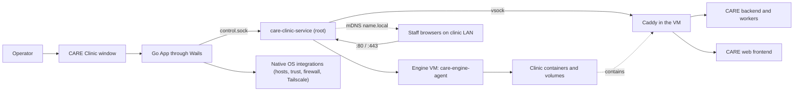
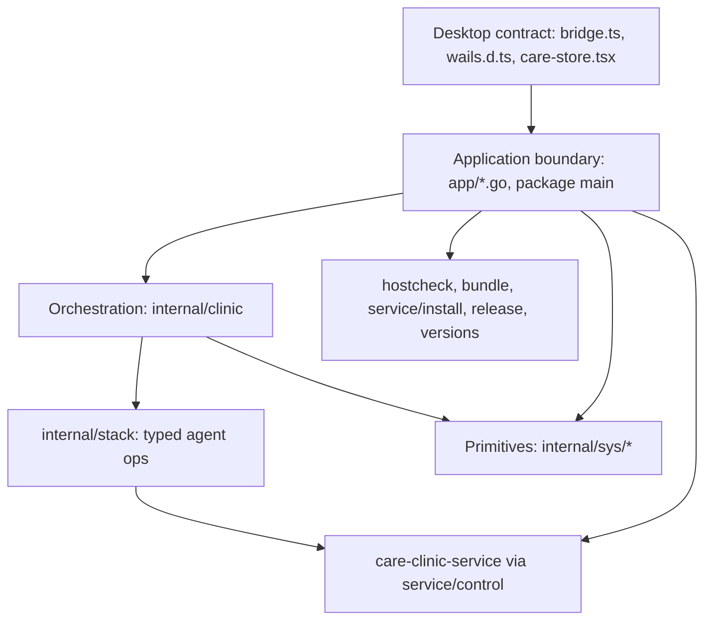

# Architecture and design choices

[Documentation index](README.md)

## The problem the backend solves

CARE Clinic runs a clinic's CARE installation on one computer without requiring the operator to administer a server. Staff use a browser to access the clinic on the local network.

Since v2 the work is split in two:

- The **desktop app** (`app/`, Wails) is only a user interface: onboarding, the control panel, settings, and client connect.
- The boot-time root **service** [`care-clinic-service`](../app/cmd/care-clinic-service/README.md) owns the engine VM (Apple Virtualization.framework, a Linux VM running the clinic containers), the agent relay, forwarding of host ports 80/443/8480 into the VM, the `<name>.local` mDNS advertisement, a watchdog, and bringing the clinic stack up after boot.

The clinic therefore keeps running when the app is closed or the user logs out.
Nothing else is installed on the host: no Docker, Docker Compose, Rancher
Desktop, Git or WSL.

The first-run Server/Client choice is persisted when the work behind it starts,
not when the question is asked, and it is not an ordinary role switch.
Client mode connects to the address shown on the server, removes what an
earlier CARE left on the computer, installs certificate trust through native
OS approval, verifies HTTPS, and opens the clinical browser application. It
needs no service. See
[native bootstrap and its trust-on-first-use limitation](native-integrations.md#native-client-setup-and-trust-on-first-use).

| Responsibility | Implementation |
| --- | --- |
| Native window and Go-to-JavaScript calls | Wails, in the desktop app. |
| Engine VM, port forwarding, mDNS, watchdog | `care-clinic-service` (LaunchDaemon `org.ohc.care-clinic`). |
| Container runtime | Docker Compose inside the engine VM, driven by typed ops of `care-engine-agent`. See [engine/README.md](../engine/README.md). |
| Clinical API and background work | The separately built CARE backend and workers. |
| Clinical browser interface | The separately built CARE frontend. |
| Relational data, cache, uploaded files | PostgreSQL, Redis, Silo (service name `minio`), in VM volumes. |
| HTTPS and reverse proxy | Caddy with the Coraza WAF module. |

## System boundary

The app reaches the service over `/var/run/care-clinic/control.sock` (group
`care-clinic`) with the client in
[`internal/service/control`](../app/internal/service/control) and the shared
types in [`internal/service/api`](../app/internal/service/api). Agent ops are
relayed by the service; the app never talks to the VM directly.

The browser used by a member of staff does not call `window.go.main.App`. That object exists in the desktop webview.

## Layers and dependency direction

### Application boundary: `package main`

The [application files](wails-application.md) own Wails callbacks, native dialogs, events, cached configuration, administrative authorization, the operation gate, and the `service-status` watcher. This is where an operation is allowed or denied; hiding a button in JavaScript is not the authorization boundary.

### Orchestration: `internal/clinic`

`Clinic` combines stack operations into setup, start, stop, restart and uninstall, and sets up this computer's hosts entry and certificate trust. `App.engine()` constructs one from a configuration snapshot with a [`stack.Runtime`](../app/internal/stack/runtime.go) bound to the service. Its UI seam is `Log func(string)` and `Confirm func(title, message string) bool`.

### Stack runtime: `internal/stack`

`Runtime` renders the deployment kit (`deployments/`) plus generated `stack.env`, `clinic.env` and `secrets.env`, uploads them to the agent's config area, and runs typed ops: image load/pull, migrate, stack up/stop/down, status, logs and `createsuperuser`. Secrets are generated once on the host and kept in `~/Library/Application Support/care-clinic/clinic/secrets.env`. See [clinic lifecycle](clinic-lifecycle.md).

### Other packages

| Package | Question it answers |
| --- | --- |
| `hostcheck` | Can this computer run the server (virtualization, memory, disk, service)? |
| `service/install` | How is the service installed from the app with one administrator prompt? |
| `bundle` | Where are the service binary and engine bundle shipped in the app? |
| `release` | Which version and image references does this executable ship? |
| `feed`, `versions` | Release tooling: the signed update feed and `versions.yml`. |

### OS primitives: `internal/sys`

These packages isolate process execution, atomic writes, logging, privileged commands, hosts entries, trust stores, the macOS firewall fix, Tailscale, mDNS name checks and app removal. The [native guide](native-integrations.md) explains the platform-specific behavior.

The dependency rule is enforced in [CI](../.github/workflows/ci.yml): `internal/` must not import `wailsapp/wails`.

## Three kinds of state

### In-process state

The [`App`](../app/app.go) owns:

| Field group | Purpose and protection |
| --- | --- |
| `ctx`, `installFS`, `pins`, `log`, `service` | Wails runtime context, embedded kit, parsed release identity, diagnostic sink, and the service client. |
| `cfg`, `configFile`, `cfgMu` | Cached persisted configuration. |
| `jobMu`, `closing`, `activeJob` | Coordination of conflicting operations and the closing transition. |
| `setupAttempt` | The unfinished setup, with its password, kept in memory only for **Try again**. |
| Confirmation and quit request state | One permission request at a time and ID-scoped quit prompts. |
| `stopWatch`, `statusMu`, `lastStatus` | The service-status watcher and the last status pushed to the UI. |

### Durable local state

`config.json` records the role, client connection, setup completion, an incomplete-removal checkpoint, the clinic name, the admin password's bcrypt hash and the app update-check switch. The install folder holds this computer's copy of the deployment kit with the editable `backend.env` and `frontend.env`. See [configuration](configuration-and-settings.md).

### External state

The service has its own state under `/Library/Application Support/care-clinic` (engine slots, VM disks, `config.json` with the mDNS name). Clinic data lives in volumes inside the engine VM. Hosts entries, trusted certificates, firewall rules and Tailscale serve settings live in the OS. The app inspects them rather than inferring them from `setup_done`.

## Lifecycle state is not service health

```mermaid
stateDiagram-v2
    [*] --> NotConfigured
    NotConfigured --> Preparing: RunSetup saves name and password hash
    Preparing --> Installed: engine, Setup and Start succeed; persist SetupDone
    Preparing --> PartialSetup: a step fails
    PartialSetup --> Preparing: RetrySetup (same process)
    PartialSetup --> NotConfigured: CleanupFailedInstall
    Installed --> Removing: RunUninstall
    Removing --> NotConfigured: cleanup completes; reset config
    Removing --> Removing: cleanup fails; retain checkpoint for retry
```

`setup_done` says the clinic was installed, not that it is running. Running state comes from the service status API (engine, stack, forwards, mDNS), pushed to the UI as `service-status`.

## Concurrency is a safety boundary

`jobMu` is a `sync.RWMutex`:

| Operation class | Mechanism | Behavior |
| --- | --- | --- |
| Long-running mutation | `run()` / `runLockedJob()` with an exclusive lock | Accepted immediately, executed in a goroutine, completion reported by `care-done`. |
| Synchronous protected mutation | `withJob()`, `withServerJob()`, `withLabeledJob()` | Caller waits for the result. |
| Environment read | `withReadJob()` with a shared lock | Multiple readers can coexist, but not with a mutation. |
| Status queries | No job lock | Stay responsive during jobs. |

Acquisition uses `TryLock` or `TryRLock`: there is no queue, and a conflict produces an explicit busy error. The service serializes engine operations on its side as well. See [the job protocol](wails-application.md#concurrency-and-job-protocol).

## Design choices and their consequences

| Choice | Why it exists | Consequence for changes |
| --- | --- | --- |
| A root service owns the VM, not the app | The clinic must run from boot, without a logged-in user, and survive app quits and updates. | The app never holds clinic-critical state; anything that must outlive it belongs in the service. |
| Typed agent ops instead of host docker | No container runtime to install or repair on the host; ops are validated in the VM. | New clinic actions need an agent op, not a shell command. |
| One mDNS advertiser per Mac | Two advertisers on one host conflict. | Only the service advertises; the app only checks names before setup. |
| Separate release pins from clinic settings | Reproducibility and operator customization have different owners. | Change `deployments/.env` for shipped versions; use the installed environment files for clinic configuration. |
| Preserve editable environments during kit refresh | App upgrades must not erase operator settings. | New template defaults are not merged into an existing clinic's files. |
| Atomic file replacement | A partially written configuration can make the app unbootable. | Use the shared primitive. |
| Batch privileged steps, then inspect results | An elevation prompt's exit status is not proof of the change. | Keep verification and actionable warnings. |

## Error handling across boundaries

A synchronous Go method returning an error rejects its Wails promise. An
asynchronous job can fail after its promise resolved, so its error is logged,
emitted as `care-error`, and followed by `care-done` code `1`.

[`care-store.tsx`](../app/frontend/src/state/care-store.tsx) owns navigation,
matching job completion and role-aware startup. Setup and uninstall require
both their success event and matching successful `care-done`, in either order.

## Where to go deeper

Follow [server onboarding](onboarding.md) for the setup order, [clinic lifecycle](clinic-lifecycle.md) for the stack, and [cleanup](cleanup-and-uninstall.md) for removal. The [file map](repository-map.md) ties each mechanism to its implementation.
