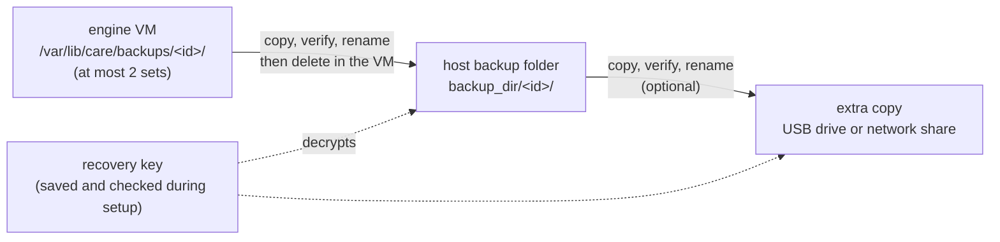

# Backups, extra copies and restore

How the clinic's data is backed up, where the copies live, what happens when
they can't be copied, and how to restore the clinic, either on the same
computer or on a new one.

Code: [`deployments/scripts/backup.sh`](../deployments/scripts/backup.sh)
(in the engine VM),
[`internal/service/backups`](../app/internal/service/backups) (the export to
the host and the extra copy),
[`cmd/care-clinic-service/backup.go`](../app/cmd/care-clinic-service/backup.go)
(`ctl backup`) and [`app/app_backups.go`](../app/app_backups.go) (the app's
Overview and Advanced actions).

## Where backups go



1. **In the VM.** The `backup` container takes a set every night at local
   midnight, before every CARE or plugins update, and on demand. A set is a
   `pg_dump` of the database and a tarball of the stored files, both
   encrypted to the clinic's backup certificate, plus `manifest.json` with
   every file's SHA-256.
2. **To the host backup folder.** `care-clinic-service` copies each complete
   set to `<backup_dir>/<id>.partial/`, checks every SHA-256, renames it to
   `<id>/` and only then deletes it in the VM. The previous host set is
   deleted only after the new one is verified, so there is always one good
   set on the host. The default `backup_dir` is
   `/Library/Application Support/care-clinic/backups`. Onboarding's
   **Setting up backups** step chooses it before install
   ([onboarding](onboarding.md#4-backups)); afterwards change it on the
   Backups tab or with `ctl config backup_dir=<folder>`. The service runs as
   root (LocalSystem on Windows); on macOS it can't write to Desktop,
   Documents, Downloads or iCloud Drive, so setup refuses those folders.
3. **Extra copy (optional).** The newest host set is also copied to a second
   folder, usually on a USB drive or a network share, in the same way:
   `<id>.partial`, verify, rename, then remove older sets there.

## When backups can't be copied out

If the host backup folder is missing (for example, its drive is
unplugged) or full, the set stays in the VM and the service tries again
every 5 minutes. Until it succeeds:

- The app's Overview **Backups** card and `ctl status` (under `backups`) say
  **"Backup not copied out since \<time\>"**, along with the error.
- The VM keeps **at most 2 sets that haven't been copied out**. A new backup
  that succeeds removes the oldest waiting set. A backup that runs short of
  disk space first deletes the oldest waiting set, but never the newest
  complete one. Waiting sets therefore can't fill the VM disk (`data.img`),
  and the only good set is never deleted.
- When 2 sets are waiting, the status is **critical**: the Overview card
  shows an alert, and the app's status line turns red. Free space in the
  backup folder or reconnect its drive. The next pass copies both sets out.

## Extra copy on a USB drive or network share

Set it up in the app under **Advanced → Backup recovery → Extra copy →
Choose folder…**, or:

```sh
B='/Library/Application Support/care-clinic/bin/care-clinic-service'
"$B" ctl backup copy set "/Volumes/CARE USB/backups"   # the folder must exist
"$B" ctl backup copy now                                # copy the newest set now
"$B" ctl backup copy clear                              # stop (the copy stays)
"$B" ctl backup status
```

- The service never creates the folder. If it's missing, the drive or
  share counts as **not connected**. The Overview card and `ctl status` then
  say "isn't connected; last copied \<time\>", and the service checks again
  every minute, copying as soon as the folder is back. **Copy now** on the
  Overview card does the same thing on demand.
- Keep room for two sets: the new one is fully written before the old one is
  removed.
- The service runs as root (on macOS, a LaunchDaemon), so a network share
  must be mounted where root can read and write it, not just in your login
  session.

## The recovery key

Backups are encrypted to the clinic's backup certificate. Only its
**recovery key** can decrypt them. Onboarding makes the pair in the
**Setting up backups** step: the operator saves the recovery file somewhere
of their choosing and selects it again so the app can check it matches.
`RunSetup` then installs that same pair as `backup-cert.pem` and
`backup-recovery-key.pem` next to `secrets.env`, before the clinic is
configured, so the file saved during setup unlocks every backup the clinic
makes. The copy on the computer is lost along with it.

Save another copy at any time: **Advanced → Backup recovery → Save recovery
key…** (this needs the CARE Clinic admin password). Store it on a USB drive
or print it, and keep it **apart from the backups**. Anyone with the key and
a backup can read the clinic's records. The app refuses to save the key inside
CARE's own settings, installation, log, backup or extra-copy folders.

## Restore on the same computer

**Advanced → Backup recovery → Restore from backup…**: choose the backup
folder (or one set inside it). The newest set there is used. Confirm the
date. The clinic stops, its database and files are replaced, and it starts
again. Everything recorded after that backup is lost.

```sh
"$B" ctl backup list
"$B" ctl backup restore daily-20260101T000000Z
```

## Restore on a new computer

You need **a backup folder** (the old computer's backup folder, the extra copy
on the USB drive or share, or any `<id>/` set from them) and **the old
clinic's recovery key**.

1. Install CARE Clinic on the new computer and finish setup as for a new
   clinic. This creates a new, empty clinic with its own certificate and
   key.
2. Connect the drive with the backups and the recovery key.
3. In **Advanced → Backup recovery**, tick **The backup came from another
   computer**, then click **Restore from backup…**. Choose the backup folder,
   then the old recovery key (`*.pem`). Check the date and restore.

   From a terminal instead:

   ```sh
   "$B" ctl backup restore --from "/Volumes/CARE USB/backups" \
       --recovery-key "/Volumes/KEYS/CARE-backup-recovery-key.pem"
   ```

   `--from` takes a folder of sets (the newest is used, or name one with
   `<id>`) or a single set folder.
4. Afterwards:
   - Staff sign in with their **old CARE passwords**, because the users come
     from the backup. Sessions from the old computer don't carry over, so
     everyone signs in again.
   - New backups are encrypted to **this computer's** certificate. Save the
     new recovery key (**Save recovery key…**) and keep it with, or in place
     of, the old one. The old key still opens the old backups.
   - Set up the extra copy again if you used one.

The restore checks every file's SHA-256 before anything is changed, so a
damaged set is refused while the clinic keeps running. The engine restores
into a new database and only swaps it in when the restore succeeds.

## Freeing space in the engine VM

Updates leave old docker images in the VM. **Overview → Storage and health →
Remove unused images**, or:

```sh
"$B" ctl engine prune --desktop-version <app version>
```

This removes images nothing uses. It keeps the images the clinic runs, the
ones from before the last CARE or plugins update (needed to roll back), the
plugin builder, and any image a container uses. Images downloaded for an
update that hasn't been applied are downloaded again when it is applied. The
prune is refused while an update is in progress.
