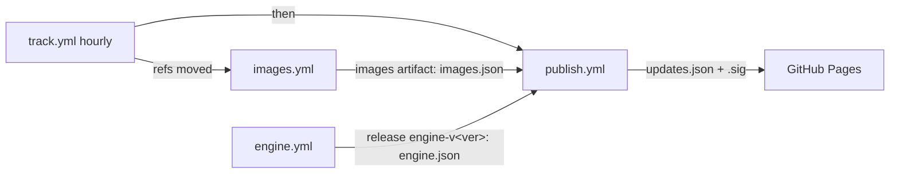

# CI publishing: images, engine, update feed

[Documentation index](README.md)

Three workflows publish what an installed clinic downloads, and a fourth
(`track.yml`) chains them to follow upstream refs. Everything goes to
this repository (`praffq/care_clinic`): images to GHCR under
`ghcr.io/praffq/care_clinic/`, engine bundles to GitHub Releases, and the
signed feed to GitHub Pages.



## images.yml

Runs on `workflow_dispatch` (optional `refs` overrides, `NAME=REF`), from
`track.yml`, and on pushes to `main` that touch `versions.yml`,
`scripts/dev-images.sh`, the image Dockerfiles/env or `demo/images/`.

- A plan job resolves the backend, frontend and plugin refs to commits once
  (`dev-images.sh --print-sources`); every build job gets that JSON through
  `--sources`, so all images of a run come from the same commits.

- One job per image and architecture on native runners (`ubuntu-24.04` for
  amd64, `ubuntu-24.04-arm` for arm64). Each runs
  `scripts/dev-images.sh --push ghcr.io/praffq/care_clinic --tag sha-<12> --arch <arch> --only <name>`,
  i.e. **the same image definitions as local dev builds** (same Dockerfiles,
  sources from `versions.yml`, build args, labels); only the output differs
  (`--push` instead of `--load` + `docker save`).
- A merge job joins the per-arch manifests into a multi-arch index tagged
  `sha-<12>-<run id>` (and `main` on main) and records its digest. The run id
keeps tags unique because `track.yml` rebuilds the same commit of this repo.
- Before merging, a smoke job pulls the amd64 `care-backend` and runs
  `scripts/smoke-backend.sh`: `manage.py check`, `migrate` and an
  `INSTALLED_APPS` assertion against a throwaway postgres and redis with every
  backend plugin enabled. A plugin that breaks CARE stops the release here.
- Registry build cache lives at `<repo>:buildcache-<arch>`.

| Package | Built from |
| --- | --- |
| `care-backend` | `care.backend` repo@ref, `docker/prod.Dockerfile`, with every backend plugin pip-installed (`ADDITIONAL_PLUGS` build arg) |
| `care-backend-builder` | the `builder` stage of the same build: `/app/.venv` with the plugins, `install_plugins.py`, git, build-essential |
| `care-frontend` | `care.frontend` repo@ref + `deployments/frontend.env`, `deployments/frontend.Dockerfile`; frontend plugins pre-built at `/plugins/<id>/` |
| `care-frontend-builder` | its `builder` stage: care_fe source with `node_modules` and `care-build-remote` |
| `care-caddy` | `deployments/caddy.Dockerfile` |
| `care-backup` | `deployments/backup.Dockerfile` |
| `care-backend-demo-b`, `care-backend-demo-c-broken` | `demo/images/*`; only when dispatched with `demo: true` |

The `images` artifact (90 days) holds:

- `images.json`: the `care` and `support_images` sections of a `release
  generate` artifacts file ([updates-feed.md](updates-feed.md)). Image refs
  are the multi-arch index digests; `backend_rev`/`frontend_rev` are the first
  12 hex digits of the upstream commits. `builders` holds the two builder
  images and `sources` every resolved repo, ref and commit (backend, frontend,
  plugins); both go into the feed's CARE release. Support images (postgres, redis,
  silo) are not rebuilt; their upstream index digests are recorded.
- `images-meta.json`: every image (including demo) with tag, index digest and
  per-arch digests.

## engine.yml

Runs on `workflow_dispatch` and on pushes to `main` touching `engine/` or the
agent sources. Builds `engine/build.sh <arch>` on native amd64 and arm64
runners, checks `engine/VERSION` equals `versions.yml` `engine.version`, and
uploads the `engine` artifact: both `care-engine-<ver>-<arch>.tar.gz`,
`SHA256SUMS` and `engine.json` (the `engine` section of an artifacts file,
with `data_schema` read from the bundles and URLs pointing at the release).

On dispatch (input `release`, default on) it creates the GitHub Release
`engine-v<ver>` with those files. An existing release is not overwritten unless
dispatched with `replace: true`; normally bump the engine version instead.

## publish.yml (manual, or called by track.yml)

1. Fails immediately if the `FEED_SIGNING_KEY` secret is missing.
2. Downloads `images.json` from the latest successful `images.yml` run on
   `main` (or `images_run_id`) and `engine.json` from release
   `engine-v<engine/VERSION>`.
3. Fetches the current `https://praffq.github.io/care_clinic/updates.json` (if
   any) as `--previous`, and runs `release generate` with revision = previous
   + 1, then `release sign` and `release verify`. It refuses the development
   key.
4. Deploys `updates.json`, `updates.json.sig` and `feed.pub` to GitHub Pages.

Inputs: `care`, `engine` (which sections to publish), `migrations`,
`expires_days` (default 30), `block` (space-separated `component:version`).

## track.yml (hourly + manual)

Keeps clinics on the latest commits of the refs in `versions.yml`:

1. Without `FEED_SIGNING_KEY` (it would build images it cannot publish), a
   scheduled run logs a notice and skips everything as a success; a manual
   dispatch fails.
2. Resolves the backend, frontend and plugin refs (`git ls-remote`) and
   compares them with `sources` of the newest CARE release in the published
   feed. No feed or no recorded sources counts as changed.
3. If anything moved (or on dispatch with `force`), calls `images.yml` with
   the resolved sources, then `publish.yml` with `care: true, engine: false`.
   The new CARE version gets a `.pl.<hash>` build suffix over the plugin
   commits, so a plugin-only change is a new release.

Dispatch inputs: `refs` (space-separated `NAME=REF`, `NAME` being `backend`,
`frontend` or a plugin id) and `force`. Ref overrides apply to that run only;
the next scheduled run goes back to `versions.yml`. Publish the first feed
manually (engine section included) before relying on the schedule.

## One-time setup

1. **Signing key.** From a trusted machine (never commit the private key):

   ```sh
   cd app
   go run ./cmd/release keygen --out ~/care-feed.key   # also writes ~/care-feed.pub
   gh secret set FEED_SIGNING_KEY -R praffq/care_clinic < ~/care-feed.key
   ```

   Keep `~/care-feed.key` in a password manager / offline backup, then delete
   the local copy. The printed public key is what the app must trust: put it in
   `feed.ProductionKeyCurrent` (`app/internal/feed/keys.go`) in a desktop
   release before clinics can accept feeds signed with it.
2. **GitHub Pages.** Settings → Pages → Source: **GitHub Actions**
   (`gh api -X POST repos/praffq/care_clinic/pages -f build_type=workflow`, or
   `-X PUT` if Pages already exists). The `github-pages` environment must allow
   deployments from `main`.
3. **Package visibility.** After the first `images.yml` run, make each package
   public so engines can pull without credentials: GitHub → your profile →
   Packages → `care_clinic/<name>` → Package settings → Change visibility →
   Public (`care-backend`, `care-frontend`, `care-caddy`, `care-backup`, and the
   demo ones if built).

## Order of a release

1. Merge the pin change (`versions.yml`, `engine/VERSION`); `images.yml` and/or
   `engine.yml` run on `main`.
2. Dispatch `engine.yml` on `main` to create `engine-v<ver>` (a new engine
   version only).
3. Dispatch `publish.yml` on `main`.
