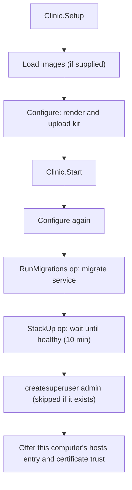
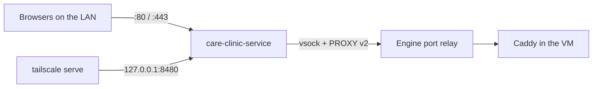

[Documentation index](README.md)

# Clinic lifecycle and deployment

This guide follows the desktop app from an installed deployment kit to a
running clinic. "Backend" has two meanings here:

- The **desktop Go backend** validates requests and drives the host service.
- The **CARE backend** is the separate Python application running in a
  container inside the engine VM.

The CARE stack runs inside the engine VM owned by
[`care-clinic-service`](../app/cmd/care-clinic-service/README.md). Every
clinic operation is a typed agent op relayed by the service; nothing runs
`docker` or `docker compose` on the host. The engine VM and its agent are
described in [engine/README.md](../engine/README.md).

## 1. Files and roles

| Code | Role |
| --- | --- |
| [`internal/clinic`](../app/internal/clinic) | `Setup`, `Start`, `Up`, `Stop`, `Restart`, `Status`, `Uninstall`, and setting up this computer (hosts entry, certificate trust). |
| [`internal/stack`](../app/internal/stack) | `Runtime`: renders the kit, uploads it to the agent's config area, and runs agent ops (images, migrate, up, stop, down, status, logs, createsuperuser). |
| [`app_onboarding.go`](../app/app_onboarding.go) | `RunSetup`: engine install, then clinic setup and start. See [server onboarding](onboarding.md). |
| [`app_actions.go`](../app/app_actions.go) | `ClinicAction(start\|stop\|restart)`, `ClinicStatus`. |
| [`app_service.go`](../app/app_service.go) | Service client, engine readiness, `service-status` watcher. |

The same API is available from the command line as `care-clinic-service ctl
clinic install|up|stop|migrate|status|logs|superuser`.

## 2. Three copies of the deployment kit

| Copy | Where | Purpose |
| --- | --- | --- |
| `deployments/` | Repository | Source: `docker-compose.yml`, `backend.env`, `frontend.env`, `Caddyfile`, `minio/entrypoint.sh`, `setup/index.html`, image Dockerfiles. |
| Install folder | `~/Library/Application Support/care-clinic/install/` | Copied from the app's embedded kit on setup and each launch. `backend.env` and `frontend.env` are preserved. |
| Engine config area | Inside the VM | What compose actually reads: the uploaded kit files plus generated files. |

`care-clinic-service ctl` embeds the kit too (`app/install`, staged by
`stage-install.mjs`; `build.sh` stages it first). Its commands that render
the kit (`clinic install`, `update`, `plugins`, `frontend`) use that embedded
kit with the clinic's `backend.env` and `frontend.env` from the install
folder, unless `--deployments dir` names another kit. A kit copied to disk
earlier is never the default: it can predate a service.

### A kit that would drop a service

Compose removes a service that the uploaded `docker-compose.yml` no longer
defines. A stale kit without `backup`, for example, removed the backup
container and every later update then failed at its backup step. So
`Configure` (the app and ctl alike) first lists the stack's services
(running or stopped) and refuses, uploading nothing, when the kit lacks one:
"the deployment kit has no backup service, which the clinic is running: the
kit is out of date, so its configuration was not applied". Updates, plugin
and frontend changes check the same in their `preflight` step, before any
backup or build, and stop at once. Only ctl can override it, with `--force`.

`Configure` uploads `docker-compose.yml` (as `compose.yml`), `backend.env`,
`Caddyfile`, `minio-entrypoint.sh` and `setup.html`, plus three generated
files:

| File | Content |
| --- | --- |
| `stack.env` | Compose interpolation: digest-pinned `IMAGE_<ROLE>` references, `CARE_HOST`, and hashes of bind-mounted files so a change recreates the container. |
| `clinic.env` | `CSRF_TRUSTED_ORIGINS`, `CORS_ALLOWED_ORIGINS` and `BUCKET_EXTERNAL_ENDPOINT` for every origin the clinic is served on (`https://<name>.local`, `https://localhost`, and the Tailscale `https://*.ts.net:8443` for CSRF). |
| `secrets.env` | Django secret, database and storage credentials. Generated once on the host, kept in `~/Library/Application Support/care-clinic/clinic/secrets.env`, never regenerated. |

`frontend.env` is not uploaded: frontend settings are baked into the frontend
image when it is built ([`scripts/dev-images.sh`](dev-images.md)).

Configuring also turns on the service's PROXY protocol header for forwarded
connections, which the Caddyfile requires.

## 3. Images

Images are digest-pinned. `Runtime.Images` loads each image from a tarball,
or pulls it by digest, and the agent verifies the digest. In this slice the
desktop app takes images from `CARE_CLINIC_DEV_IMAGES` (a `scripts/dev-images.sh`
output folder) or reuses the images already pinned in the engine's
`stack.env`. Release images come in a later slice. There is no image building
on the clinic computer and no CARE software update path; see
[dev images](dev-images.md).

## 4. Setup and Start

- **Migrations before workers.** The one-shot `migrate` service (profile
  `migrate`) runs `migrate`, `sync_permissions_roles` and `sync_valueset`.
  `backend`, `celery-worker` and `celery-beat` depend on it completing.
  `celery-beat` does not run upstream's `celery_beat.sh`, which migrates on
  every start.
- **Admin login.** `createsuperuser` gets the password through a short-lived
  file in the config area, never in op parameters. An existing `admin` is left
  alone.
- **This computer.** Setup's Start fetches the clinic's root
  certificate from `http://127.0.0.1/root.crt` (through the service's port
  80) and offers, in one confirmation, the hosts entry and certificate trust
  so this Mac's browser opens `https://<name>.local/`. Declining doesn't stop
  the clinic. See [native integrations](native-integrations.md).

`Clinic.Start` runs only during setup. The panel's Start and Restart bring
the already uploaded configuration up without re-uploading it, so a changed
`backend.env` in the install folder reaches the engine only when the clinic
is configured again (for example `ctl clinic install`).

## 5. Panel actions and boot

| Action | What runs |
| --- | --- |
| Start | Wait for the engine (starting it if stopped), then `StackUp`. |
| Stop | `StackStop`: containers and data kept. |
| Restart | Wait for the engine, `StackStop`, `StackUp`. |
| Status | `StackStatus`: one line per container. |

None needs the admin password. The service itself brings an installed stack
up after every engine boot (so the clinic returns after a reboot without the
app), never migrates or updates, and stops the stack before shutting the VM
down. Its watchdog restarts the VM after a crash or an unresponsive agent.
The panel shows this through `service-status`.

## 6. Deployment inventory

[`docker-compose.yml`](../deployments/docker-compose.yml) is compose project
`care` on a pinned `172.30.0.0/24` network. All long-running services use
`restart: unless-stopped` and `pull_policy: never`.

| Service | Image | Notes |
| --- | --- | --- |
| `db` | PostgreSQL | Volume `postgres-data`. |
| `redis` | Redis | Volume `redis-data`. |
| `minio` | Silo (compatibility name kept) | Volume `minio-data`; entrypoint creates the buckets. |
| `migrate` | Backend | One-shot, profile `migrate`. |
| `backend`, `celery-worker`, `celery-beat` | Backend | After db, redis and migrate. |
| `frontend` | Frontend | Settings baked at build time. |
| `caddy` | Caddy with Coraza | Publishes `127.0.0.1:80`, `:443`, `:8480` inside the VM only; volumes `caddy-data`, `caddy-config`. |

The volumes live in the engine VM. Stop keeps them; uninstall with "also
delete clinic data" removes them.

The storage service keeps the `minio` service name, `MINIO_*` variable names
and the `minio-data` volume although it runs Silo. Renaming them would
disconnect existing data.

### Ports and Caddy routes

| Listener | Behavior |
| --- | --- |
| `:80` | Bootstrap routes (`/root.crt`, `/setup`), otherwise redirect to HTTPS. |
| `<name>.local:443` | Caddy's internal CA; bootstrap routes, `/api/*` through Coraza to `backend:9000`, `/static`, `/ping`, `/health` to the backend, bucket paths to `minio:9000`, everything else to `frontend:80`. |
| `http://:8480` | Home access through Tailscale; same site routes, sets `X-Forwarded-Proto: https`. See [home access](home-access.md). |
| `localhost:443` | `/ping/*` only. |

`:80` and `:443` accept connections only with a PROXY v2 header from the
network gateway, which is where the engine's port relay connects from. The CA
names `CARE Clinic Local CA` and `CARE Clinic Local CA - Intermediate` are
also native cleanup identifiers.

## 7. Invariants

- The host never runs a container runtime; new clinic actions need an agent op.
- Secrets are generated once; reinstalling keeps them.
- Install is safe to repeat: only changed containers are recreated.
- Uploaded configuration takes effect on the next stack up.
- Uninstall with data removal (`StackDown` with volumes) also deletes the
  uploaded config, so the service stops bringing the stack up after boot, and
  the host copy of the secrets.

Tests: [`stack_test.go`](../app/internal/clinic/stack_test.go) and the
`internal/stack` tests cover rendering, secrets and the op sequence.
