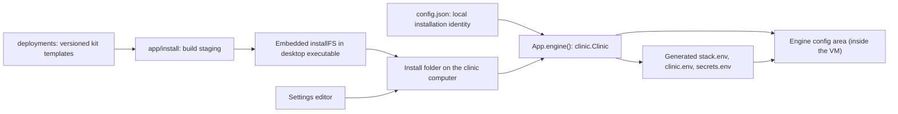

# Configuration and settings

[Documentation index](README.md)

The app has several configuration layers. Understanding their ownership prevents a common mistake: changing a source template while expecting an already installed clinic to read it.

## Configuration layers



| Layer | Owner | Purpose |
| --- | --- | --- |
| `deployments/.env` | Maintainer | Desktop version, upstream repositories/commits and image pins. |
| Other `deployments/` files | Maintainer | The compose file, initial environment templates, proxy configuration and setup page. |
| `app/install/` | Build process | Staging for Go embedding; not the place for source edits. |
| Embedded `installFS` | Desktop executable | Immutable copy of the kit used by that build. |
| Install folder | Application | The kit uploaded to the engine by `Configure`. |
| Installed `backend.env` / `frontend.env` | Clinic operator | Clinic-specific settings preserved during kit refresh. |
| Engine config area | `internal/stack` | What compose in the VM reads. See [clinic lifecycle](clinic-lifecycle.md#2-three-copies-of-the-deployment-kit). |
| `config.json` | `App` | Role, client connection, setup/removal state, clinic name, CARE Clinic administrator hash and the app update-check switch. |

## Local paths

[`configPath()`](../app/app_config.go) starts with Go's `os.UserConfigDir()`, falls back to `os.UserHomeDir()` on failure, requires an absolute result, and appends `care-clinic/config.json`.

[`installDir()`](../app/app_installdir.go) normally places `install` beside that configuration file. On Windows, when an absolute home directory is available, it lives under the user's home directory instead.

| Platform | Typical configuration file | Typical install folder |
| --- | --- | --- |
| macOS | `~/Library/Application Support/care-clinic/config.json` | `~/Library/Application Support/care-clinic/install/` |
| Windows | `%AppData%\care-clinic\config.json` | `%UserProfile%\care-clinic\install\` |
| Linux | `$XDG_CONFIG_HOME/care-clinic/config.json`, normally `~/.config/care-clinic/config.json` | `install/` beside `config.json`. |

The clinic's generated secrets are kept in `clinic/secrets.env` beside
`config.json`. The engine, its slots and VM disks belong to the service under
`/Library/Application Support/care-clinic`; patient data lives in volumes inside
the VM. The diagnostic log location is described in
[native integrations](native-integrations.md).

The install folder contains:

```text
install/
|-- .env
|-- docker-compose.yml
|-- backend.env
|-- frontend.env
|-- Caddyfile
|-- caddy.Dockerfile
|-- backup.Dockerfile      # shipped but not uploaded in v2
|-- scripts/
|   `-- backup.sh          # shipped but not uploaded in v2
|-- minio/
|   `-- entrypoint.sh
`-- setup/
    `-- index.html
```

Keys and configuration are sensitive and must not be treated as disposable cache.

## Persisted `Config`

Entering actual setup persists the choice to host a clinic (**Server**);
attempting a connection persists the choice to use a clinic (**Client**). The
Start screen itself only navigates and does not save a role. Clients retain the
clinic address and use native certificate bootstrap. Role selection is not an
ordinary settings toggle; it remains locked until successful uninstall.
Failed-install cleanup/retry preserves it. The one exception is the **Back**
button on the setup and client screens, which undoes a choice nothing has been
built on yet (see `ClearRole` below).

Client connection state includes the saved clinic URL, the public pinned
certificate (`client_certificate`), and whether this client installed it
(`client_certificate_owned`). Certificate ownership is used for exact-certificate
cleanup, not broad removal of every CARE root. Neither the PEM nor ownership
flag is exposed in `AppState`; its client fields are `role` and `client_url`.
The pin and ownership state are persisted before OS elevation to preserve retry
and cleanup information. Subsequent connects use the saved pin rather than
silently accepting a new HTTP certificate. **Disconnect** clears the
connection, certificate state and role after successful removal; failures keep
retry state. See [client removal](native-integrations.md#removing-client-access).

[`app_config.go`](../app/app_config.go) defines a small JSON object:

| JSON field | Go field | Meaning |
| --- | --- | --- |
| `role` | `Role` | Persisted `server` or `client`; empty before setup/connection begins and after successful uninstall. Failed-install cleanup does not reset it. |
| `client_url` | `ClientURL` | Normalized HTTPS clinic address for a client, empty when disconnected. |
| `client_certificate` | `ClientCertificate` | Pinned public root PEM; omitted when empty. |
| `client_certificate_owned` | `ClientCertificateOwned` | Whether this client owns certificate installation/cleanup; omitted when false. |
| `setup_done` | `SetupDone` | Setup, including starting CARE, succeeded and that result was saved. |
| `removing` | `Removing` | Destructive cleanup began but may not have completed. Omitted when false. |
| `mdns_name` | `MDNSName` | Saved clinic name label, such as `care`. |
| `admin_pw_hash` | `AdminPwHash` | Bcrypt hash for local CARE Clinic administrative authorization. |
| `app_update_checks_off` | `AppUpdateChecksOff` | Set from Advanced with the admin password to stop CARE Clinic app update checks. Omitted when false. See [Turning update checks off](#turning-update-checks-off). |

The plaintext administrator password is not stored. Setup passes it into CARE
administrator creation; later CARE Clinic password changes affect only the
local bcrypt hash, not the CARE web login.

### Load rules

A missing file is the only ordinary first-run fallback. Other read errors propagate. Invalid JSON, JSON `null`, a non-object value and an invalid saved clinic name stop initialization with a descriptive error. Server fields with a client role are a conflict error; server fields without a role infer Server.

There is no versioned configuration migration framework. JSON decoding uses the current struct and ignores unknown fields, so fields written by older versions are dropped on the next save.

The first-run question itself writes nothing: `BeginServerSetup()` persists the
Server role when the operator enters setup, and `ConnectClient` persists the
Client role when a connection is attempted. A different role is rejected once
one is set. A populated install folder without a role also infers Server.
`ClearRole()` is the escape hatch for a misclick: it writes an empty `Config`
only while nothing is set up, meaning the install folder is empty and the file
holds nothing beyond `role` and `mdns_name` (the setup form saves the default
name as soon as it opens). Otherwise it refuses with the uninstall-first
message. A client that has connected therefore has no Back button;
**Disconnect** is its way out.

`App` loads the file once into a cache guarded by `cfgMu`. `App.loadConfig()` returns a struct copy. Editing `config.json` externally does not update the running cache.

### Write and forget rules

`saveConfig()` serializes indented JSON and uses `atomicfile.Write` with mode `0600`. It updates the in-memory copy only after the write succeeds.

`forgetConfig()` retains the role: for a server it writes a role-only
configuration after failed-install cleanup; for a client it preserves the
current configuration. Successful uninstall calls `resetConfigAfterUninstall()`
to clear everything, including the role.

Atomic replacement protects a single file. It is not a transaction across the engine, the two environment files and `config.json`.

## Setup configuration order

[`RunSetup(name, adminPassword)`](../app/app_onboarding.go) validates the name
and password, rejects an installed or removing clinic, saves the name and the
administrator's bcrypt hash (`SetupDone` still false), refreshes the install
folder, installs the engine if needed, then runs `Clinic.Setup()` and
`Clinic.Start()`. Only the job's successful completion persists
`SetupDone=true`. See [server onboarding](onboarding.md).

A failure after configuration or files were created is a partial setup, not
proof that nothing was installed. While the app stays open, `RetrySetup()`
repeats the same attempt; otherwise the UI offers
[failed-install cleanup](cleanup-and-uninstall.md).

## Embedded-kit refresh

`ensureInstallDir()` walks the embedded `install` tree. It skips the placeholder, creates directories, writes shell scripts as executable, and copies other kit files with ordinary file modes. It runs during setup and, for a set-up server not being removed, at each launch.

Its preservation list contains exactly `backend.env` and `frontend.env`: existing copies are not overwritten. Other kit files are refreshed from the executable, including `.env`, so the shipped pins do not become an independently editable runtime release mechanism. A new template key is not merged into an existing environment file.

The refreshed kit reaches the engine the next time the clinic is configured (setup, or `ctl clinic install`).

## Advanced access and authorization

[`advanced-tab.tsx`](../app/frontend/src/screens/panel/advanced-tab.tsx) starts a
fixed `15 * 60 * 1000` millisecond timer after a successful password unlock.
Typing, navigation within settings groups and other activity do not extend it.
Leaving Advanced, leaving the panel or using Lock clears the unlock sooner.
A successful password change starts a fresh unlock with the new password.

Expiry clears the retained password, selected settings group and mounted
sensitive/unsaved form state. The page reports that Advanced has locked.
Already written files and accepted native jobs are not rolled back; saved
settings that still need applying remain distinguishable from an unsaved draft.

This timer exists in React. Go does not issue a 15-minute session token or
remember a globally unlocked administrator. `ReadEnv`, `WriteEnv`,
`ChangeAdminPassword`, `SetUpdateChecks` and `RunUninstall` validate the
supplied CARE Clinic password through their native guards. Start, Stop and
Restart need no password.

The CARE Clinic password is distinct from the operating-system password used for
privilege prompts and from the CARE web login after initial setup. Six one-time
recovery codes, saved during setup or later from Advanced, can reset it.

## Environment-file API

[`envPath()`](../app/app_env.go) accepts only `backend` and `frontend`, mapping them to fixed filenames under the installed kit. It is not an arbitrary file-reading or file-writing API.

`ReadEnv` checks the CARE Clinic administrator password and setup state under a shared read lock, then reads the entire installed file. File errors are returned; there is no fallback to the repository template or an empty settings object.

`WriteEnv` checks the administrator password and setup state under the exclusive lock. It validates syntax using `compose-go/dotenv`, then atomically writes the selected file as `0600`.

This syntax check is not full application-specific validation. The friendly editor adds field-level constraints; a direct caller can submit settings the dotenv parser accepts but CARE later rejects.

## Applying settings

The desktop's settings integration uses these modules:

| File | Role |
| --- | --- |
| [`env-editor.tsx`](../app/frontend/src/screens/panel/env-editor.tsx) | Loads both files, tracks changed fields, validates the draft, writes changes, and requests Start or Restart. |
| [`env-file.ts`](../app/frontend/src/lib/env-file.ts) | Parses line records, reads values, quotes changes, and serializes the result. |
| [`advanced-env.ts`](../app/frontend/src/screens/panel/advanced-env.ts) | Validates values, summarizes groups, and merges only changed keys into freshly read files while preserving unrelated bytes. |
| [`env-schema.ts`](../app/frontend/src/screens/panel/env-schema.ts) | Maps user-facing fields to keys, files, control types, defaults, bounds, and managed-key notes. |
| [`env-controls.tsx`](../app/frontend/src/screens/panel/env-controls.tsx) | Converts the raw string/undefined draft into a suitable control without replacing explicit zero with an empty value. |

Saving re-reads both files, applies only the edited keys to the fresh lines,
writes each changed file with `WriteEnv` and reloads. It then requests
`ClinicAction("restart")` when the clinic is running, otherwise `start`.

`WriteEnv` alone does not restart anything; saving and applying are two
operations. Start and Restart run `Up` with the configuration already in the
engine; they do not upload the install folder again. A changed `backend.env`
therefore reaches the engine only when the clinic is configured again, for
example with `care-clinic-service ctl clinic install`. See
[clinic lifecycle](clinic-lifecycle.md#5-panel-actions-and-boot).

This flow is not a multi-file transaction. If a later file write fails, earlier
successful writes remain; if applying fails, the saved settings stay saved.

### Parsing and customization boundaries

The editor retains a list of comments, blank lines, and `KEY=value` records rather than regenerating a file from a plain object. Duplicate recognized keys use the last value when reading; changes update all recognized occurrences so an older duplicate cannot silently win.

The Advanced merge layer recognizes ordinary and `export` assignments, spacing
around the equals sign, and quoted multiline values. Unedited comments, blank
lines, line endings and secret values remain byte-for-byte unchanged. Edited
assignments are quoted and normalized individually; new values use the file's
existing line-ending convention. Friendly controls and new custom edits require
single-line values. This is still not a replacement for the native dotenv parser.

The normal clinic editor exposes these everyday choices:

| Group | Settings |
| --- | --- |
| Clinic details | Clinic display name and languages for staff. |
| Patients and visits | Usual visit type and a shorter registration form. |
| Billing | Usual payment method, payment instructions, tax-inclusive prices and opening a bill after dispensing. |
| Staff access | How long inactive staff stay signed in. |

Less-used local options, such as logos, country defaults, enabled visit types,
form preferences and queue refresh timing, are not part of these groups. They
keep their existing values or CARE's defaults and can be overridden in
**Extra settings (for support)**. Saving an everyday choice does not reset or
insert those options. When `REACT_ALLOWED_ENCOUNTER_CLASSES` is saved, the usual
visit selector lists only those visit types; a saved choice that is no longer
enabled shows as "Current value isn't listed" and cannot be saved again.

The visit type and payment method choices use the same names and order as CARE
(`ENCOUNTER_CLASS` with the `encounter_class__*` labels, and
`PAYMENT_RECONCILIATION_METHOD_MAP`, in care_fe), so staff see one word for each
in both places. Keep them in step when CARE adds or renames one.

Email and patient sign-in/SMS controls are not offered. Their environment keys,
along with SMTP, OTP, MFA/TOTP and reCAPTCHA configuration, are hidden from
"Extra settings (for support)" and cannot be added there. Existing values
remain untouched when other settings are saved.

CARE Clinic sends no email or SMS:

| Channel | Setting | Effect |
| --- | --- | --- |
| Email | `DJANGO_EMAIL_BACKEND=django.core.mail.backends.dummy.EmailBackend` | Django's dummy backend discards every message. Password reset by email, new-user "set your password" email and two-factor notices report success instead of failing against a mail server. The shipped `backend.env` sets it. |
| SMS | `USE_SMS=False` | No SMS is sent. Patient sign-in by code is the one CARE flow that fails without SMS, so it stays hidden with `REACT_DISABLE_PATIENT_LOGIN=true`. |

The old `EMAIL_HOST`/`EMAIL_USER`/`EMAIL_PASSWORD` and `SNS_*` placeholders are
no longer shipped; CARE has defaults for all of them. Existing files that still
contain them are left alone. The "Forgot password" link on CARE's sign-in page
cannot be hidden through settings. This is an editor restriction, not a change
to CARE's authentication or existing MFA configuration. Branding URLs can
point to assets hosted on the clinic's local network.

Undescribed non-hidden keys appear in "Extra settings (for support)." New
`REACT_` keys are directed to the frontend; other new keys go to the backend.
The editor rejects duplicate names, names already owned by a described control,
and protected keys.

Protected keys cannot be changed through this editor, including
`ADDITIONAL_PLUGS`, service credentials and generated connection settings.
The editor preserves their latest file contents when saving other changes.
This is an interface policy, not a new native security boundary: authenticated
`WriteEnv` still validates syntax rather than an application-specific key
allow-list.

### Defaults and manual overrides

Explicit values in the installed environment files override CARE's corresponding
defaults. The settings panel edits those same files; it is not a separate
configuration layer. Friendly controls replace their own keys, and the support
editor can add or change other permitted keys. Before saving, both paths read
the latest files and merge only the operator's edits.

Frontend values are baked into the frontend image when it is built
([dev images](dev-images.md)). Saving `frontend.env` from the panel (or
`ctl frontend set`) rebuilds the frontend in the VM with the changed
`REACT_*` settings as one journaled operation that rolls back on failure;
only supported settings and plain values are accepted
([plugins.md](plugins.md#frontend-settings-react_)).
Clearing an optional friendly control removes its assignment and lets CARE's
default apply. In the support editor, an explicitly blank `KEY=` stays blank;
blank and missing values can behave differently depending on the CARE setting.
The editor's fallback hints do not write defaults into the file.

The new-install frontend template includes these visit/address settings:

| Key | Shipped value | Meaning |
| --- | --- | --- |
| `REACT_DEFAULT_ENCOUNTER_TYPE` | Empty | No explicit preset. A single enabled visit type is selected automatically; otherwise staff choose. Set `hh` for Home Health. |
| `REACT_PATIENT_REG_MIN_GEO_ORG_LEVELS_REQUIRED` | `0` | The currently configured CARE frontend clamps this to **1 required address level**, not an optional address. |
| `REACT_PATIENT_REGISTRATION_DEFAULT_GEO_ORG` | Unset (commented example) | No prefilled area. A support override must use the UUID of an existing CARE geographic organization, not its name. |

The address settings are support-only. CARE's current behavior is defined in
[`care.config.ts`](https://github.com/ohcnetwork/care_fe/blob/90d9a412e179584d5534d354bd4c7c61f42452da/care.config.ts#L283-L303).
Unlike generic extra settings, the default area cannot have a blank assignment:
CARE's [build validator](https://github.com/ohcnetwork/care_fe/blob/90d9a412e179584d5534d354bd4c7c61f42452da/scripts/validate-env.ts)
requires a UUID when this key is present. The editor rejects blank or malformed
area IDs; remove the setting to clear the default area.
Existing installations preserve their `frontend.env`, so template changes do
not replace an existing clinic's choices or migrate missing keys automatically.

## Managed values

`internal/stack` generates the clinic's domain wiring in `clinic.env` (trusted
origins, CORS origins and the external bucket endpoint), image references and
host in `stack.env`, and the Django secret and service credentials in
`secrets.env`. Compose reads them after `backend.env`, so their values win. Read the
[clinic lifecycle](clinic-lifecycle.md) before changing how the hostname or
public bucket URLs are derived.

The storage configuration retains `MINIO_IMAGE`, `MINIO_ROOT_*`, the service name `minio`, and its existing data volume even though the server executable is Silo. Those identifiers are compatibility and ownership contracts.

Treat both environment files as sensitive. Frontend values are incorporated into browser-delivered assets and must not be used to hide a secret from staff browsers.

## Updates

Only the CARE Clinic app updates itself: the app card compares the installed
version with the newest published GitHub release and can download and launch
the verified installer. See [the update protocol](wails-application.md) and
[releases](releases.md). CARE software updates were removed in v2; they return
later via engine agent ops.

### Turning update checks off

**Advanced → Update checks** has one switch, **Check for CARE Clinic app
updates**. Advanced must be unlocked first. Changing it sends that admin
password to `SetUpdateChecks(app, adminPassword)`, which checks it again and
saves `app_update_checks_off`. It defaults to on. With checks off, CARE Clinic
never contacts GitHub for a release check or an install, and the card shows
"Checks off" without Check now or Update buttons. An update already
downloading or installing finishes.

## Relevant regression coverage

[`app_env_test.go`](../app/app_env_test.go) covers concurrent environment reads, mutation exclusion, and administrator/lifecycle guards. [`app_role_test.go`](../app/app_role_test.go) covers role selection and `ClearRole`.

The underlying atomic-file behavior and the stack rendering have their own tests, indexed in [the repository map](repository-map.md).

[`advanced.spec.ts`](../app/frontend/tests/advanced.spec.ts) covers the
15-minute unlock boundary, tab-leave clearing, sensitive field handling,
latest-file merging and failed apply behavior.
