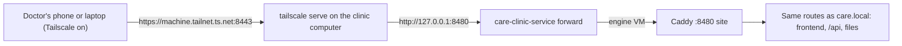

# Home access

[Documentation index](README.md)

Home access lets a doctor open CARE from home without exposing the clinic to
the internet. It uses [Tailscale](https://tailscale.com): the clinic computer
joins the clinic's own Tailscale account, and the clinic shares that one
computer with each doctor. Only people it is shared with can reach CARE.

## How a request reaches CARE

| Piece | Where | Why |
| --- | --- | --- |
| Loopback port `8480` | The [service](../app/cmd/care-clinic-service/README.md) listens on `127.0.0.1:8480` and forwards into the engine VM, where `docker-compose.yml` publishes Caddy's `8480` | Only this computer can reach it. The clinic Wi-Fi cannot, so it never offers CARE over plain HTTP to the LAN. |
| `http://:8480` site | `deployments/Caddyfile`, `import site` | Serves the same routes as the `.local` site. TLS is handled by Tailscale, so this listener alone trusts its local proxy (`trusted_proxies static private_ranges`) and sets `X-Forwarded-Proto: https`, so CARE builds `https` links and redirects. The LAN listeners still ignore a forwarded scheme sent by a client. |
| `tailscale serve --bg --https=8443 http://127.0.0.1:8480` | [`internal/sys/tailscale`](../app/internal/sys/tailscale/tailscale.go) | Gives the computer a `*.ts.net` address with a certificate phones already trust, so doctors install no certificate. Port 8443, not 443: on macOS, Tailscale listens on the serve port on every address of the computer, so serving on 443 takes the port away from the clinic and `<clinic>.local` stops working. |
| Empty `REACT_CARE_API_URL` | `deployments/frontend.env` | The CARE frontend calls the API on the address the page was opened from, so one build works as `<clinic>.local` and as the `ts.net` address. |
| `https://*.ts.net:8443` in `CSRF_TRUSTED_ORIGINS` and `CORS_ALLOWED_ORIGINS` | Generated `clinic.env` ([`internal/stack`](../app/internal/stack/render.go)) | Django admin forms work from the `ts.net` address. Django matches the port too, so the origin must include `:8443`. Every clinic gets it at install, so turning home access on changes no settings. |

## Desktop panel

The **Home access** tab in the control panel rail, after Overview, holds the
home access card. The card reads `HomeAccessStatus` when the panel
opens, when the clinic's state changes and on **Check again**; it does not poll,
and visiting the tab does not trigger a check by itself. Its actions are locked
while another panel operation or an app update is running. It leads the
manager through, in order: install Tailscale, sign in, turn on HTTPS
certificates in the Tailscale admin console, then **Turn on home access**. Once
it is on, the card shows the address, a **Doctor instructions** dialog with a
QR code, and **Share with a doctor**, which opens the computer's page in the
Tailscale admin console.

CARE Clinic only ever changes the `/` handler on port 8443 that points at its
own loopback port, and removes a port 443 handler pointing there that an early
test build created. Any other `/` handler on port 8443, whether it proxies,
serves files or serves text, is reported as a conflict and left alone. If
Tailscale's serve configuration can't be read, the card says so and turning
home access on is refused, rather than risking an overwrite.

Turning home access on only configures `tailscale serve`; it changes no clinic
settings. `EnableHomeAccess` asks the panel to restart the clinic only when the
loopback port is not answering. If something else is already served there, the card
reports a conflict and does not overwrite it. Uninstall turns home access off
on a best-effort basis and logs, rather than fails, if Tailscale cannot be
reached.

## Setting it up

Clinic manager, once:

1. Create the Tailscale account with a clinic-owned email.
2. Install Tailscale on the clinic computer and sign in.
3. In the admin console, under **DNS**, keep MagicDNS on and turn on **HTTPS Certificates**.
4. In the admin console, under **Machines**, disable key expiry for the clinic computer.
5. In CARE Clinic, choose **Turn on home access**.

For each doctor:

1. Manager: **Share with a doctor**, then **Share** in Tailscale, and enter the doctor's email.
2. Doctor: install Tailscale, sign in with any account, accept the share email.
3. Doctor: with Tailscale on, open the address from **Doctor instructions** and bookmark it.

To remove a doctor, revoke the share in the Tailscale admin console and
deactivate their CARE account if they are leaving.

## Known limits

- Files: CARE builds file links from `BUCKET_EXTERNAL_ENDPOINT`, which points at
  `<clinic>.local`; the default `care_multihost_files_be` plugin
  ([plugins.md](plugins.md)) lets them work from `*.ts.net` too.
- The clinic computer must stay on and awake.
- Server setup is macOS-only until the Windows service exists.
