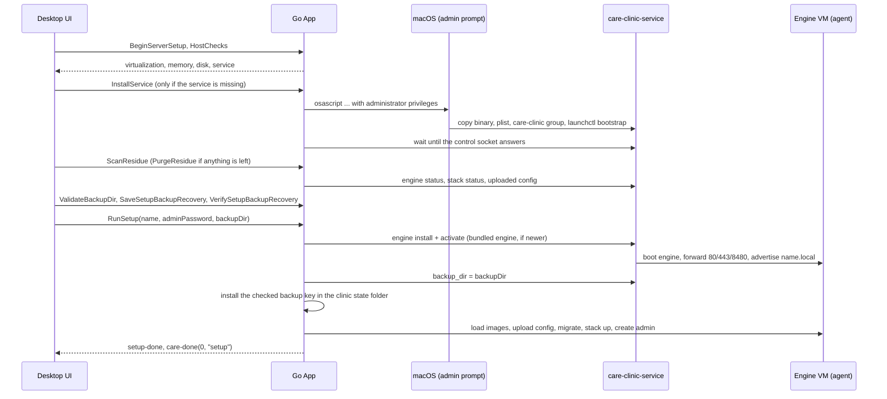

# Server onboarding

[Documentation index](README.md)

Setting up a Mac as the clinic server takes these steps in the desktop app:
**computer checks**, **cleanup of an earlier setup**, **clinic name**,
**backups**, **admin password**, a **review** and **install**. The
app only drives the steps; the engine VM and the clinic containers belong to
the boot-time [`care-clinic-service`](../app/cmd/care-clinic-service/README.md).
Nothing is installed on the host besides that service: no Docker, Rancher
Desktop, Git or WSL.

Server setup is macOS-only for now. The Windows app compiles, but the Windows
service comes in a later slice, so server setup is not available there.

## 1. Computer checks

`BeginServerSetup` saves the Server role, then `HostChecks()` returns a
[`hostcheck.Report`](../app/internal/hostcheck/hostcheck.go): a list of checks,
each `ok`, `warn` or `fail`, and `ready`, which is false while any check fails.
Warnings do not block setup.

| Check | Fails when | Warns when |
| --- | --- | --- |
| Virtualization | Not a Mac with Apple silicon, or the hypervisor is unavailable. | — |
| Memory | Less than 8 GiB (the engine VM uses 4 GiB). | — |
| Disk | Less than 20 GiB free where the service keeps the engine (`/Library/Application Support/care-clinic`). | Less than 40 GiB free. |
| Service | The control socket does not answer. On macOS the check carries the `install-service` action. | The check isn't available on this system yet (Windows). |

### Installing the service

When the service check fails with `install-service`, the UI offers to install
it. `InstallService()` ([`internal/service/install`](../app/internal/service/install))
shows **one** macOS administrator prompt (`osascript` `do shell script ... with
administrator privileges`) whose script:

1. creates the `care-clinic` group if missing and adds the logged-in user;
2. copies `Contents/MacOS/care-clinic-service` from the app bundle (or
   `CARE_CLINIC_SERVICE_BINARY`) to
   `/Library/Application Support/care-clinic/bin/care-clinic-service`;
3. writes `/Library/LaunchDaemons/org.ohc.care-clinic.plist`, booting out a
   running copy first;
4. runs `launchctl bootstrap system`.

The app then waits up to a minute for the control socket
`/var/run/care-clinic/control.sock` to answer. Group membership normally
applies only to new logins, so the socket is not group-restricted on disk
(`0666`): the service checks each caller's uid itself and admits root and
members of `care-clinic`, reading membership from the user database as well as
the caller's login groups. The installing user can use the app straight away,
with no log out. Declining the prompt installs nothing.

Developers can install the same service with `scripts/service-macos.sh
install` or `install-built` (needs sudo); see
[development](development-and-release.md#the-care-clinic-service).

## 2. Cleanup of an earlier setup

The wizard page **Cleanup stale files** comes right after the computer
checks, so the service is already running. `ScanResidue()` returns a
[`residue.Report`](../app/internal/residue/residue.go): `clean` and the list of
traces an earlier CARE Clinic (v1 or v2) left on this computer. Continue stays
disabled until a scan is clean, and Review does not re-run it.

| Trace | Found when | Blocks setup |
| --- | --- | --- |
| `engine` | The engine is installed and its stack has containers or an uploaded `stack.env`, or the engine is stopped, crashed or backing off so its data couldn't be checked. | Yes |
| `containers`, `volumes`, `networks` | Docker answers and has v1 resources labelled `com.docker.compose.project=care-clinic`. | Yes |
| `images` | Docker answers and has `ghcr.io/ohcnetwork/care*` images. | No |
| `install-dir` | The install folder (`.../care-clinic/install`) exists. | Yes |
| `secrets` | The host copy of `secrets.env` exists in the clinic state folder. The backup certificate and recovery key next to it are kept. | Yes |
| `config` | `config.json` holds a password hash, `setup_done` or `removing`. A saved role or clinic name alone is not a trace. | Yes |
| `hosts`, `certificate` | A `# care-clinic` hosts line, or a trusted `CARE` root certificate. | Yes |
| `firewall` | CARE's own Windows firewall rules (`CARE Clinic <name>`). The service's `CARE Clinic` rule is not counted. | No |
| `autostart` | The v1 start-at-login entry: `~/Library/LaunchAgents/ohc.care-clinic.plist`, `~/.config/autostart/care-clinic.desktop`, or the `CARE Clinic` value under `HKCU\...\Run`. | Yes |

A service that does not answer, or an engine that is starting, stopping or not
ready, makes the scan fail rather than report clean. A stopped Docker is not
checked: its old containers can't hold ports or data open, and v1 volumes are
never attached to the engine.

**Remove it all** calls `PurgeResidue(true)`, which refuses a finished clinic
(use Uninstall instead), persists `removing`, and then:

1. If the scan found `engine`, waits for the engine (starting it if stopped)
   and runs `Clinic.Uninstall` with `RemoveData`: `StackDown` with volumes,
   the uploaded config files and `secrets.env`. Without it, `SkipStack` leaves
   the engine alone.
2. Reverts the hosts entry, certificate trust, CARE firewall rules and
   Tailscale home access, then deletes the install folder.
3. Removes the v1 Docker containers, volumes, networks and CARE images
   (an image still in use is logged and kept), the v1 start-at-login entry and
   any remaining `secrets.env`.
4. Forgets the settings except the role, rescans, and fails while anything
   blocking is left.

The service, the engine slots, backups already exported to the backup folder,
the backup key, admin recovery codes and the log stay. Approval prompts are the
same as for Uninstall: the in-window confirmation for the hosts file, and the
operating system's own password prompt.

## 3. Clinic name

The clinic name becomes `<name>.local` (default `care`). `MDNSStatus` and
`ValidateDomain` check it before setup; `RunSetup` checks again that no other
computer on the network advertises it, unless this Mac's service already does.
Keep other clinic servers awake during setup: an offline computer cannot be
detected.

## 4. Backups

The **Setting up backups** step chooses where the service exports the
nightly backups and makes the key that unlocks them. Continue stays disabled
until the folder checks out and the recovery file is saved and checked.

**Folder.** It starts at the service's current `backup_dir` (by default
`/Library/Application Support/care-clinic/backups`); **Change folder**
(`ChooseFolder`) picks another. `ValidateBackupDir` returns a problem, or
`""`, and `BackupDirSpace` the free space shown under the path. A chosen
folder must:

- be an absolute path that is not the top of a drive (the service's own rule);
- not be inside CARE's install, settings, clinic state or log folders, and not
  hold the saved recovery file;
- exist and be a folder, and be writable (a probe file is created and
  removed), so read-only drives such as NTFS on a Mac are refused;
- not already hold backup sets: the service prunes older sets in its folder,
  so another installation's backups there would be deleted;
- on macOS, not be in Desktop, Documents, Downloads, iCloud Drive or
  `~/Library/CloudStorage`: privacy protection keeps the root
  `care-clinic-service` LaunchDaemon out of them;
- have at least 1 GB free.

The service's current folder (left unchanged) is root-owned, so only the path,
CARE-folder and space rules apply to it; the service creates it under an
existing parent.

**Recovery file.** **Choose where to save** (`SaveSetupBackupRecovery`)
generates the clinic's backup certificate and its RSA recovery key
(`stack.GenerateBackupKey`), writes the key where the operator chooses
(never over an existing file, never inside CARE's folders or the backup
folder) and keeps both in `setup-backup.json` (`0600`) in the clinic state
folder, unchecked. **Select saved file** (`VerifySetupBackupRecovery`) reads
the chosen file and checks that its key matches the certificate; cancelling
keeps an earlier check, any other failure clears it. **Save a new recovery
file** (`ReplaceSetupBackupRecovery`) makes a new pair, which must be checked
again; the old file then unlocks nothing this clinic makes.
`GetSetupBackupStatus` also re-reads the saved file, so a moved, damaged or
different file (`missing`, `unreadable`, `mismatch`) needs checking again
before installing. On Windows, **Open folder**
(`OpenSetupBackupRecoveryFolder`) shows the file in File Explorer. Once
installation starts (the admin password hash is saved) these calls refuse.

## 5. Admin password

The CARE Clinic admin password must be 8 to 20 characters with an uppercase
letter, a lowercase letter and a digit (`ValidatePassword`). It protects the
Advanced settings, uninstall and update-check switches, and becomes the
password of the CARE web login `admin`. Only its bcrypt hash is saved.

Once the password is valid and confirmed, the admin step asks for six one-time
recovery codes and keeps Continue disabled until they are saved:

- `SaveSetupRecoveryCodes()` opens a save dialog and writes the sheet to the
  chosen file. It never overwrites a file, and refuses CARE's install,
  settings, clinic state, log and backup folders. "" means the dialog was
  cancelled. Saving again issues a new set; the old codes stop working.
- `GetSetupRecoveryStatus()` reports `codes_saved`, `codes_path` and
  `codes_problem` (`missing`, `unreadable` or `mismatch` when the sheet was
  moved, damaged or no longer holds every active code).
- `OpenSetupRecoveryCodes()` opens the sheet for printing;
  `OpenSetupRecoveryFolder()` selects it in Explorer (Windows only).

The codes use the same storage as the control panel's: only their hashes are
kept, in `admin-recovery.json` in the clinic state folder. They are
independent of the password, so changing the password after saving them
keeps them valid, and `RunSetup` leaves the file alone. After installation
`GetAdminRecoveryCodeCount` reports 6 and `ResetAdminPassword` accepts them.
These setup calls are locked once `RunSetup` has stored the password hash, the
clinic is installed or it is being removed; after that, new codes come from
Advanced and need the admin password. Review checks the codes again before
installing. Cleaning up a failed install keeps the saved codes for the next
attempt; Uninstall deletes them.

## 6. Install

`RunSetup(name, adminPassword, backupDir)` validates its input synchronously
(including the backup folder, and that the recovery file is saved, checked
and still matches), then runs the `setup` job:

1. Save the name and password hash in `config.json`.
2. Wait for the service, then **install the engine** if needed. The app uses
   the engine bundle shipped in `Contents/Resources/engine` (or
   `CARE_CLINIC_ENGINE_BUNDLE`). It installs and activates it through the
   service, the same as `ctl install` and `ctl activate`, when no engine is
   installed or the bundled version is newer than the active one. With no
   bundle, an already installed engine is used; otherwise setup fails.
3. Wait up to 5 minutes for the engine to be ready, starting it if stopped,
   and tell the service the clinic name to advertise.
4. Set the service's `backup_dir` to the chosen folder (an empty `backupDir`
   keeps the service's own), then install the checked certificate and key as
   `backup-cert.pem` and `backup-recovery-key.pem` in the clinic state folder
   and delete `setup-backup.json`. A different pair already there (from an
   earlier clinic on this computer) is kept beside them as
   `*.replaced-<time>`, since it still unlocks that clinic's backups. Because
   the host certificate now exists, `Clinic.Setup` uploads it to the engine
   instead of generating or adopting another, so every backup is encrypted to
   the key the operator saved.
5. Copy the deployment kit to the install folder, then `Clinic.Setup` puts
   the CARE images in the engine (see [Where the images come
   from](#where-the-images-come-from)) and uploads the rendered configuration.
6. `Clinic.Start` migrates the database, brings the stack up, creates the
   `admin` login and offers to set up this Mac's browser for
   `https://<name>.local/` (hosts entry and certificate trust; skipping it
   doesn't stop the clinic).
7. When CARE came from the update feed, record that release as installed
   (`Coordinator.RecordInstall`), then re-apply the clinic's recorded plugins
   and frontend settings (`Coordinator.Reinstalled`).

### Where the images come from

In this order:

1. `CARE_CLINIC_DEV_IMAGES` (a [`scripts/dev-images.sh`](dev-images.md)
   output folder). It always wins, so development never touches the feed.
2. The images the engine's clinic already runs (its `stack.env`), so a clinic
   can be configured again without downloading anything.
3. Otherwise the **update feed**: the newest CARE release this app and the
   running engine can install. This is the normal path on a new computer.

The feed path (`Clinic.Setup` calls `Clinic.FromFeed`, which `RunSetup` wires
to `feedRelease` in `app_onboarding.go`) reuses the update coordinator
([updates.md](updates.md)):

1. `Coordinator.LatestCompatible` fetches `updates.json` (`CARE_UPDATES_URL`,
   else the published feed) and verifies it with the same rules as an update
   check: signed by a trusted key, or unsigned only in a build that allows
   unsigned feeds, with the same warning in the log. The verified feed is
   saved in `verified.json`. From `care[]` it picks the newest release
   (semver, then `released_at`) that is not in `blocked` and whose `requires`
   hold for this app's version and the engine version the agent reports
   (`feed.LatestCompatibleCare`). The images are the release's `images`, the
   feed's `support_images` and the release's `builders` (not part of the
   stack, but custom plugins and frontend settings need them later).
2. `Coordinator.PrepareInstall` checks the engine's free disk space before
   anything is downloaded: 2 GiB plus twice the `size` the feed gives for
   every image not yet in the engine (an image without `size` counts 0).
   Development feeds with `tar` URLs have their tarballs downloaded here.
3. `Runtime.Images` pulls each image by digest with the agent's `image.pull`
   op, the same path an update's pre-fetch and images step use, and the agent
   checks every pulled image carries its digest. Progress goes to the
   "Downloading CARE" step as "Downloading CARE server (2 of 9)" with the
   bytes the op reports. Every image that arrives is remembered for the
   attempt (`Runtime.Have`), so **Try again** skips images already in the
   engine and continues with the rest.
4. `Clinic.Configure` renders the kit pinned to the release's images; the
   rest of setup runs unchanged (migrations, admin login, plugins, health).
   The release's `build_env` is what its frontend image was built with, so
   the clinic starts on the release's frontend settings, and
   `FrontendSettings` reports them as the release's.
5. After `Clinic.Start`, `Coordinator.RecordInstall` writes `installed.json`
   as a committed CARE update would (CARE version, `released_at`, every image
   digest, the active engine) and adds an `applied` history entry with the
   feed revision. Builders are looked up in the verified feed by that version,
   so `ctl update check`, plugins and `ctl frontend` work without `--images`.

`ctl clinic install` without `--images` does the same from the command line
(it needs `--desktop-version` and a feed URL; see
[clinic lifecycle](clinic-lifecycle.md#3-images)).

### Setup errors

The failure screen shows the error in plain words (`SetupFailure.message`,
from `setupErrorMessage` in `app_onboarding.go`); the log file keeps the raw
error.

| Cause | Message | Try again helps |
| --- | --- | --- |
| No internet, update server down (`updates.ErrFeedUnreachable`) | "Couldn't reach the update server. Check the internet connection and try again." | Yes |
| Feed fails verification | "CARE Clinic couldn't verify the update server's list of releases. …" | Later |
| No compatible release (`feed.NoCompatibleError`) | What is needed, e.g. "CARE 3.1.0 needs app ≥ 0.3.0 (this app is 0.2.0); update the app first." | After updating |
| Not enough engine disk (`updates.DiskSpaceError`) | "There isn't enough free space to download CARE (… free, … needed). …" | After freeing space |
| Image download failed (`stack.ImageError`) | "Couldn't download the CARE web app image. Check the internet connection and try again; finished downloads are kept." | Yes |
| Image missing from the registry, or wrong digest | "The CARE web app image (repo@digest) isn't available from the image registry. Trying again won't help; …" | No |

Progress streams to the UI as `care-log` lines. Success emits `setup-done`
and `care-done(0, "setup")`, and saves `setup_done`. A failure emits
`setup-failed {can_retry, message}`:

- **Try again** (`RetrySetup`) resumes the same attempt while the app is still
  open, skipping preparation that already finished.
- Otherwise `CleanupFailedInstall` removes the clinic from the engine and this
  computer's install files, then setup starts over. The service and engine
  stay installed.

After setup the service keeps the clinic running: it boots the engine at
startup, brings the stack up after each engine boot, and advertises the name.
Quitting the app does not stop the clinic.

## Facility setup

Reaching the control panel means the clinic is installed; it does not mean a
facility, staff or clinical catalog exists in CARE. Facility setup happens in
the CARE web application. The CARE Onboarding frontend plugin is served by
the clinic and enabled in CARE's admin dashboard ([plugins.md](plugins.md)).
