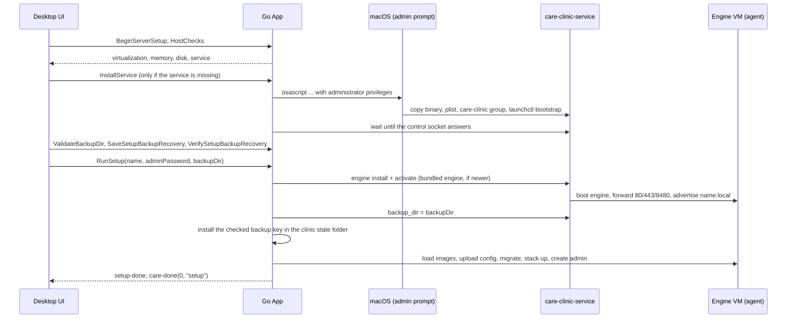

# Server onboarding

[Documentation index](README.md)

Setting up a Mac as the clinic server takes these steps in the desktop app:
**computer checks**, **clinic name**, **backups**, **admin password**, a
**review** and **install**. The
app only drives the steps; the engine VM and the clinic containers belong to
the boot-time [`care-clinic-service`](../app/cmd/care-clinic-service/README.md).
Nothing is installed on the host besides that service: no Docker, Rancher
Desktop, Git or WSL.

Server setup is macOS-only for now. The Windows app compiles, but the Windows
service comes in a later slice, so server setup is not available there.

## 1. Computer checks

`BeginServerSetup` saves the Server role, then `HostChecks()` returns a
[`hostcheck.Report`](../app/internal/hostcheck/hostcheck.go): a list of checks,
each `ok`, `warn` or `fail`, and `ready`, which is false while any check fails.
Warnings do not block setup.

| Check | Fails when | Warns when |
| --- | --- | --- |
| Virtualization | Not a Mac with Apple silicon, or the hypervisor is unavailable. | — |
| Memory | Less than 8 GiB (the engine VM uses 4 GiB). | — |
| Disk | Less than 20 GiB free where the service keeps the engine (`/Library/Application Support/care-clinic`). | Less than 40 GiB free. |
| Service | The control socket does not answer. On macOS the check carries the `install-service` action. | The check isn't available on this system yet (Windows). |

### Installing the service

When the service check fails with `install-service`, the UI offers to install
it. `InstallService()` ([`internal/service/install`](../app/internal/service/install))
shows **one** macOS administrator prompt (`osascript` `do shell script ... with
administrator privileges`) whose script:

1. creates the `care-clinic` group if missing and adds the logged-in user;
2. copies `Contents/MacOS/care-clinic-service` from the app bundle (or
   `CARE_CLINIC_SERVICE_BINARY`) to
   `/Library/Application Support/care-clinic/bin/care-clinic-service`;
3. writes `/Library/LaunchDaemons/org.ohc.care-clinic.plist`, booting out a
   running copy first;
4. runs `launchctl bootstrap system`.

The app then waits up to a minute for the control socket
`/var/run/care-clinic/control.sock` to answer. Group membership normally
applies only to new logins, so the socket is not group-restricted on disk
(`0666`): the service checks each caller's uid itself and admits root and
members of `care-clinic`, reading membership from the user database as well as
the caller's login groups. The installing user can use the app straight away,
with no log out. Declining the prompt installs nothing.

Developers can install the same service with `scripts/service-macos.sh
install` or `install-built` (needs sudo); see
[development](development-and-release.md#the-care-clinic-service).

## 2. Clinic name

The clinic name becomes `<name>.local` (default `care`). `MDNSStatus` and
`ValidateDomain` check it before setup; `RunSetup` checks again that no other
computer on the network advertises it, unless this Mac's service already does.
Keep other clinic servers awake during setup: an offline computer cannot be
detected.

## 3. Backups

The **Setting up backups** step chooses where the service exports the
nightly backups and makes the key that unlocks them. Continue stays disabled
until the folder checks out and the recovery file is saved and checked.

**Folder.** It starts at the service's current `backup_dir` (by default
`/Library/Application Support/care-clinic/backups`); **Change folder**
(`ChooseFolder`) picks another. `ValidateBackupDir` returns a problem, or
`""`, and `BackupDirSpace` the free space shown under the path. A chosen
folder must:

- be an absolute path that is not the top of a drive (the service's own rule);
- not be inside CARE's install, settings, clinic state or log folders, and not
  hold the saved recovery file;
- exist and be a folder, and be writable (a probe file is created and
  removed), so read-only drives such as NTFS on a Mac are refused;
- not already hold backup sets: the service prunes older sets in its folder,
  so another installation's backups there would be deleted;
- on macOS, not be in Desktop, Documents, Downloads, iCloud Drive or
  `~/Library/CloudStorage`: privacy protection keeps the root
  `care-clinic-service` LaunchDaemon out of them;
- have at least 1 GB free.

The service's current folder (left unchanged) is root-owned, so only the path,
CARE-folder and space rules apply to it; the service creates it under an
existing parent.

**Recovery file.** **Choose where to save** (`SaveSetupBackupRecovery`)
generates the clinic's backup certificate and its RSA recovery key
(`stack.GenerateBackupKey`), writes the key where the operator chooses
(never over an existing file, never inside CARE's folders or the backup
folder) and keeps both in `setup-backup.json` (`0600`) in the clinic state
folder, unchecked. **Select saved file** (`VerifySetupBackupRecovery`) reads
the chosen file and checks that its key matches the certificate; cancelling
keeps an earlier check, any other failure clears it. **Save a new recovery
file** (`ReplaceSetupBackupRecovery`) makes a new pair, which must be checked
again; the old file then unlocks nothing this clinic makes.
`GetSetupBackupStatus` also re-reads the saved file, so a moved, damaged or
different file (`missing`, `unreadable`, `mismatch`) needs checking again
before installing. On Windows, **Open folder**
(`OpenSetupBackupRecoveryFolder`) shows the file in File Explorer. Once
installation starts (the admin password hash is saved) these calls refuse.

## 4. Admin password

The CARE Clinic admin password must be 8 to 20 characters with an uppercase
letter, a lowercase letter and a digit (`ValidatePassword`). It protects the
Advanced settings, uninstall and update-check switches, and becomes the
password of the CARE web login `admin`. Only its bcrypt hash is saved. There
are no recovery codes.

## 5. Install

`RunSetup(name, adminPassword, backupDir)` validates its input synchronously
(including the backup folder, and that the recovery file is saved, checked
and still matches), then runs the `setup` job:

1. Save the name and password hash in `config.json`.
2. Wait for the service, then **install the engine** if needed. The app uses
   the engine bundle shipped in `Contents/Resources/engine` (or
   `CARE_CLINIC_ENGINE_BUNDLE`). It installs and activates it through the
   service, the same as `ctl install` and `ctl activate`, when no engine is
   installed or the bundled version is newer than the active one. With no
   bundle, an already installed engine is used; otherwise setup fails.
3. Wait up to 5 minutes for the engine to be ready, starting it if stopped,
   and tell the service the clinic name to advertise.
4. Set the service's `backup_dir` to the chosen folder (an empty `backupDir`
   keeps the service's own), then install the checked certificate and key as
   `backup-cert.pem` and `backup-recovery-key.pem` in the clinic state folder
   and delete `setup-backup.json`. A different pair already there (from an
   earlier clinic on this computer) is kept beside them as
   `*.replaced-<time>`, since it still unlocks that clinic's backups. Because
   the host certificate now exists, `Clinic.Setup` uploads it to the engine
   instead of generating or adopting another, so every backup is encrypted to
   the key the operator saved.
5. Copy the deployment kit to the install folder, then `Clinic.Setup` loads the
   CARE images into the engine and uploads the rendered configuration.
6. `Clinic.Start` migrates the database, brings the stack up, creates the
   `admin` login and offers to set up this Mac's browser for
   `https://<name>.local/` (hosts entry and certificate trust; skipping it
   doesn't stop the clinic).

Images come from `CARE_CLINIC_DEV_IMAGES` (a
[`scripts/dev-images.sh`](dev-images.md) output folder) or, failing that, the
images the engine's clinic already runs. Release images come in a later
slice; without either, setup fails and suggests `ctl clinic install --images`.

Progress streams to the UI as `care-log` lines. Success emits `setup-done`
and `care-done(0, "setup")`, and saves `setup_done`. A failure emits
`setup-failed {can_retry}`:

- **Try again** (`RetrySetup`) resumes the same attempt while the app is still
  open, skipping preparation that already finished.
- Otherwise `CleanupFailedInstall` removes the clinic from the engine and this
  computer's install files, then setup starts over. The service and engine
  stay installed.

After setup the service keeps the clinic running: it boots the engine at
startup, brings the stack up after each engine boot, and advertises the name.
Quitting the app does not stop the clinic.

## Facility setup

Reaching the control panel means the clinic is installed; it does not mean a
facility, staff or clinical catalog exists in CARE. Facility setup happens in
the CARE web application. The CARE Onboarding frontend plugin is served by
the clinic and enabled in CARE's admin dashboard ([plugins.md](plugins.md)).
