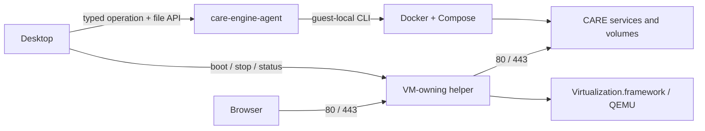

# The CARE engine and operation agent

[Documentation index](README.md)

CARE's Docker daemon, Compose, image builds and container commands run beside
the **CARE engine agent**, not in the desktop process. macOS and Windows use a
small Linux VM; Linux runs the same agent natively. There is no host Docker
CLI download, Docker relay, Docker-context selection, host-folder sharing,
Windows path conversion or bidirectional folder synchronization.

## Transport and operations

`app/internal/engine` sends `POST /v1/jobs` requests with a typed operation,
arguments, a guest working directory and selected clinic environment values.
The agent validates operations and executes its **own** Docker/Compose tools.
Supported operations cover Compose up/down/stop/ps/logs/pull/run/exec, image
build/inspect/tag/remove, container and volume inspection/removal, and daemon
health/version. Host `PATH`, Docker context and unrelated host credentials are
not forwarded. The local process runner rejects Docker invocations.

Responses are flushed NDJSON frames for stdout and stderr followed by an
explicit exit status or execution error. A broken stream without its terminal
frame is a failure. Cancellation closes the request and terminates the guest
CLI process group on Linux; it does not roll back work the daemon has already
committed. Detached services intentionally survive their Compose request.

On Windows, QEMU forwards only the agent control channel on host loopback
47377 to guest 2377, with the existing per-install mutual TLS identity.
macOS uses its private VZ vsock channel. Because the VZ socket handle belongs to
the VM-owning process, the helper forwards agent HTTP over its private 0600
control socket; it does not interpret Docker operations. Neither platform
exposes a Docker daemon endpoint. The helper still owns VM boot/shutdown,
80/443 forwarding, lifecycle diagnostics and existing persistent mDNS
advertising. It no longer owns file replication or Docker command execution.

Native Linux uses `/run/care-engine-agent/control.sock`, accessible only to
root and the configured clinic group. The system service runs the same agent
with `--socket`, alongside system dockerd. Residue checks do not treat a missing
agent socket as an empty installation: retained engine data, agent installation
records or Docker configuration require agent recovery before volumes can be
declared clean. Native mode does not expose the VM
mount, clock or shutdown endpoints, so it cannot power off the host through the
VM shutdown API.

## Explicit input and output transfer

The agent's file put/get/list/delete API is the only transfer channel:

- The installed deployment and generated configuration are uploaded before
  runtime operations. Secrets retain private modes and never appear in job
  command logs. Guest-owned backup state is not overwritten from the host.
- Image builds upload the selected Dockerfile and isolated build context under
  a unique guest build directory, then remove those inputs after completion.
- Restore helpers upload selected backup inputs and the recovery key, use
  explicit guest bind paths, and remove temporary key/input files afterward.
- Backups and WAL originate on the persistent local engine disk. Host exports
  feed backup health, recovery selection and the optional verified extra-copy
  worker. Export failures are errors, not a successful empty backup listing.

The VM's `/var/lib` is the persistent data disk. `/var/lib/care/clinic`,
`/var/lib/care/backups` and `/var/lib/care/builds` contain agent-owned runtime
inputs, backups and temporary builds. There are no mirrored drive roots or
home-directory shares. Backups share disk capacity with Docker images and
volumes; uploads retain the existing space reserve checks.

## Installation, start and updates

The VM bundle includes the kernel, initrd, read-only system image and data-disk
seed. Docker, Compose, Buildx and the agent are part of the guest definition.
Root `versions.toml` is the human-edited version/pin source, and signed release
metadata authorizes immutable downloads. See [the redesign](redesign.md).

`vm.Ensure` starts the VM helper and waits for the agent to report Docker
readiness. Starting the clinic **never applies a staged update**. The update
coordinator is the only authority for changing installed versions.

`app/internal/vm/update.go` retains the transactional engine update:

1. Download, verify and stage the new bundle and Windows QEMU before touching
   the running engine.
2. Journal activation before moving the current engine/tools aside and
   atomically replacing the installed pointer.
3. Boot the new engine and verify the reported version and clinic health.
4. Commit only after success; otherwise stop the new engine and restore the
   old bundle/tools. Interrupted activation is recovered before ordinary boot.

The data disk is never rolled back by an engine update. Database recovery
continues to use verified backups, PITR bounds and the staged/journaled swap.

## Windows QEMU

Windows uses QEMU with Windows Hypervisor Platform (WHPX). Setup downloads the
pinned QEMU installer directly from Stefan Weil's distributor, plus the pinned
official 7-Zip bootstrap and installer. Every download is SHA-256 verified.
Both installers are treated only as archives: **neither installer is
executed**. The private extractor runs with a deadline and is removed
afterward. There is no system-wide QEMU/7-Zip installation or PATH change.
The emulator, DLLs, resources and distributor notices remain in CARE's private
tools directory, and the driver uses `-L <qemu>/share`. QEMU activation and
rollback remain part of the engine transaction.

The conservative `Nehalem` CPU model avoids WHPX failures caused by exposing
unsupported CPU features. Virtualization must be enabled in firmware and the
Windows Hypervisor Platform feature enabled, possibly followed by a restart.
Ports 80 and 443 must be available and permitted on the clinic's private LAN.

## State, builds and diagnostics

Engine state lives under
`~/Library/Application Support/care-clinic/vm` on macOS and
`%LOCALAPPDATA%\care-clinic\vm` on Windows. macOS's short control-socket path is
`~/.care-clinic/run`. `data.img` is sparse and grows up to the configured size
(64 GB by default). `bin/` contains Windows QEMU, not desktop Docker tools.
Engine logs live in the shared [diagnostics folder](local-logs.md).

`vm/flake.nix` and `vm/nix/guest.nix` define the NixOS guest.
`vm/nix/bundle.nix` produces the checksummed bundle. `vm/agent` contains the
operation, file and diagnostics APIs. `.github/workflows/engine.yml` builds
immutable engine release assets. Existing macOS Apple ID signing/notarization
and Windows SignPath desktop signing are unchanged.

Unit/HTTP fixtures exercise operation framing, transfer errors, cancellation
and rollback, but are not a substitute for a real macOS VZ boot, Windows WHPX
boot, native Linux service installation or production PITR replay/swap.
