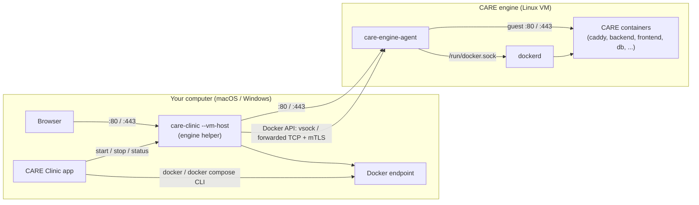

# The CARE engine (Docker on macOS and Windows)

[Documentation index](README.md)

CARE runs as Docker containers. Linux servers run Docker natively. macOS and
Windows can't run Linux containers directly, so CARE Clinic ships its own small
Linux virtual machine, the **CARE engine**. It runs only Docker and a tiny agent.
Nothing else needs to be installed manually: there is no separate container
desktop app in the menu bar, and CARE Clinic controls the engine version.
Pre-VM installations and migrations are not supported.



## What the app does

- **Install.** The setup screen's Docker step installs the engine: a
  `care-engine-<version>-linux-<arch>.tar.gz` bundle (kernel, initrd, a
  read-only system image and an empty data-disk seed), the `docker` CLI and
  the `docker compose` plugin, plus QEMU and temporary extraction tools directly
  from their distributors on Windows. Every file comes from a
  version and SHA-256 pinned in `deployments/.env`.
- **Start.** `vm.Ensure` launches the engine helper (`care-clinic --vm-host`,
  the same executable). The helper boots the VM, waits for Docker inside it,
  and exposes it to the computer. Quitting a running clinic offers **Leave
  running** or **Stop**. Stop stops containers and the VM; leaving it running
  preserves them. A capable helper also keeps the host-side mDNS responder
  running after the window quits. Linux and older helpers retain window-owned
  advertising; the quit dialog warns when persistent advertising is unconfirmed.
- **Run.** The app points every `docker` / `docker compose` call at the
  engine with `DOCKER_HOST`, `DOCKER_CONFIG` and a `PATH` that puts the
  engine's own CLI first (`vm.Env`). Nothing reads the user's Docker contexts.
- **Ports.** The helper listens on ports 80 and 443 and forwards them into the
  VM, where Caddy publishes the clinic. Only those two ports are forwarded.
- **Update.** When `CARE_VM_VERSION` changes in a new app release, the setup
  check shows "Update CARE engine". App self-updates leave a running engine in
  place, so on panel launch the app compares the installed and running
  engine with the pin and updates it automatically before reporting clinic
  status (the panel shows "Updating" rather than "Running"). An unfinished
  restore or plugin rollback takes priority and skips this automatic upgrade
  until recovery completes. The data disk (images, volumes, clinic data) is
  kept. The update is one transaction; see [Engine update rollback](#engine-update-rollback).

### Persistent clinic-name discovery

The host helper, not the Linux guest, advertises an installed server's `.local`
name. [`advertisement.go`](../app/internal/vm/advertisement.go) atomically saves
the desired name, install directory, enabled state and ownership grant in private
`StateDir()/advertisement.json`. Settings changes and removal synchronize this
record; stopping containers withdraws advertising without forgetting the name.
Staff clients never enable it.

The window stops its responder **before** granting a capable helper ownership,
then asks `POST /advertisement` to reload and verify it. Generic settings writes
preserve that grant. An older running helper retains window ownership; an
unreachable helper does not trigger a competing window responder. Capability
and current responder/probe/error/conflict status are returned by `/status`.

The helper requires the installed compose file, Docker readiness, running
`caddy`, `backend` and `frontend` services belonging to the installed
`care-clinic` project, and HTTP 200 from the clinic's loopback HTTPS `/ping/`.
This is an availability check, not proof of trusted TLS, full clinical health
or remote LAN reachability. Windows also checks existing `netfix` profile and
port rules; failures report repair details to logs/status, and the app's
**Fix network** action performs the existing elevated repair.
An otherwise available clinic name remains advertised while repair details
are surfaced.

During boot, `/status` already reports the helper's advertising capability, but
no responder runs until readiness and attachment complete. Advertisement refresh
and withdrawal are acknowledged without probing at this stage. `/stop` cancels
disk copying, readiness polling and attachment, and shuts down or kills a
partially started machine before the helper exits. macOS framework start itself
cannot be interrupted; cancellation releases the caller and stops a machine
that completes starting later. Single native setup syscalls remain synchronous.

Helper housekeeping checks availability, interface changes, foreign-name
conflicts and direct hostname responses every 15 seconds. App jobs queue one
cancellable, coalescing reconciliation worker, which re-reads the latest settings;
slow health and name probes do not delay job completion. Stop, removal and name
changes synchronously cancel probing and withdraw the responder through
`POST /advertisement/withdraw`, before background verification can resume.
External container changes can take until the next poll. Conflicts withdraw the responder;
two consecutive response misses also withdraw it before retry. VM stop and helper
exit withdraw it immediately. Helper logs persist, and reopening reads current
status. A quit-time refresh must confirm the matching name and successful probe
before the leave-running warning is removed.

Networking notices use the separate `care-network-status` channel, deduplicated
by the window and shown independently from clinic-job errors. A confirmed name
conflict has a conflict-specific title; helper, ownership and probe failures have
a generic advertising title. Recovery clears the notice without changing a job's
result. Setup skips helper reconciliation before clinic installation; native
Linux retains its deliberate pre-start advertising and preflight conflict check.
The older-helper capability check concerns a still-running **VM-era** desktop
executable after an app update, not a pre-VM installation. Restarting that helper
is necessary to load the new host-side advertising API; replacing the guest image
alone cannot add it.

Engine update/rollback stops the old helper and withdraws its responder; the
replacement reuses the persisted desired state and grant, advertising only when
CARE is available again. A pre-capability helper still needs restarting from a
new desktop executable to gain persistence: upgrading the guest alone is not
enough. These paths are covered by isolated tests; real macOS/Windows LAN and
firewall validation remains necessary.

### Engine update rollback

`prereq.installEngineThen` and [`vm/update.go`](../app/internal/vm/update.go)
replace the engine bundle and its host tools (docker CLI, compose plugin and,
on Windows, QEMU) together:

1. **Stage.** Every download is checksum-verified, then unpacked and the
   bundle's per-file hashes checked into `engine-update/new/`. The running
   clinic is untouched; a failure here only reports the error.
2. **Activate.** The clinic containers are removed (volumes kept) and the VM
   stopped. `engine-update/record.json` is written before anything is moved.
   The current tools move to `engine-update/old/`, the new ones into place,
   the new bundle into `engine/<version>/`, and `engine/current` is replaced
   atomically. The previous bundle stays on disk.
3. **Verify.** The new engine is started; Docker must answer (including
   `docker compose`) and the helper must report the new version.
4. **Commit or roll back.** On success the record is removed and the previous
   bundle and tools are deleted; CARE is then started. If activation or
   verification fails, the partly started VM is stopped, the previous tools
   and `current` pointer are put back, the new bundle is deleted, the record is
   marked `failed` with the cause, and the clinic is started on the previous
   engine. Errors from the update, the restore and the restart are all reported.

If CARE Clinic quits or the computer loses power between activation and
commit, the next launch stops the engine (its helper outlives the app) and
rolls back before anything else uses it. The same recovery runs before every
engine start and Docker-readiness check, so a recovery that failed once is
tried again before CARE starts.

A failed update is not retried automatically: the panel shows **CARE engine
update required** with the cause and a **Try the update again** button. The
retry clears the failed record and runs the whole transaction again. A newer
CARE Clinic that pins a different engine updates automatically as usual.
Download failures change nothing and leave no failed record.

Limits:

- The data disk is shared by both engines and is never copied or reverted.
  Anything the new engine wrote to it (for example Docker metadata) stays.
- Once the new engine and Docker answer, the update is committed. A later CARE
  start or migration failure is handled by normal CARE recovery and restore,
  not by going back to the previous engine. Database migrations are never
  rolled back by an engine rollback.
- A first install has no previous engine; a failed first install removes the
  partial install instead.

## Platforms

| | macOS (12.3+, Apple silicon and Intel) | Windows 10/11 (x64) |
| --- | --- | --- |
| Hypervisor | Apple Virtualization framework (built in) | QEMU with Windows Hypervisor Platform (WHPX) |
| One-time setup | None | Turn on *Windows Hypervisor Platform* (admin prompt, then restart). Virtualization must be enabled in the BIOS/UEFI. |
| Docker endpoint | Unix socket `~/.care-clinic/run/docker.sock`, carried over vsock | `tcp://127.0.0.1:<port>` with mutual TLS (keys created per install) |
| Host folders in containers | Shared live with virtiofs at the **same path** (your home folder and `/Volumes`) | Mirrored: the install and backup folders are copied into the VM and synced both ways |
| App signing | Needs the `com.apple.security.virtualization` entitlement (`app/build/darwin/entitlements.plist`) | None |

### Windows folder sync

The VM on Windows can't see the computer's folders, so the helper keeps a copy
of the install folder and the backup folder inside the VM. It syncs before and
after every Docker command that uses those files (compose up, backups,
restores) and every 15 seconds in between. When the same file changed on both
sides since the last sync, the computer's copy wins.

The guest mirrors live under `/var/lib/care-sync` on the persistent data disk,
not the disposable guest root. If a guest mirror is unexpectedly empty while
the host still has files, the helper restores the guest from the host instead
of interpreting the missing files as host deletions. The Windows mirror shares
the data disk's capacity with Docker images and clinic data.

All drive letters A-Z use persistent mirror roots. Guest uploads are serialized
and checked before allocating the full replacement temporary file, then again
in bounded chunks. They preserve 5 GiB of free space, matching the desktop's
critical running-space policy. Windows backup estimates reserve the same 5 GiB;
an unmeasurable shared destination fails rather than claiming a successful
backup. Sync failure is an operation error, not just a log warning.
This is headroom mitigation, not a quota: Docker/Postgres can independently
consume the shared disk, and large backup folders still require enough guest
capacity as well as host capacity.

## Where things live

| | macOS | Windows |
| --- | --- | --- |
| Engine state (engine files, data disk, logs, config) | `~/Library/Application Support/care-clinic/vm` | `%LOCALAPPDATA%\care-clinic\vm` |
| Sockets | `~/.care-clinic/run` | `%LOCALAPPDATA%\care-clinic\vm\run` |

Inside that folder: `engine/` (the installed bundle and `manifest.json`),
`engine-update/` (only while an update is staged, being verified, or after it
failed),
`data.img` (the sparse data disk that holds Docker's images, containers and
volumes; it grows as needed, up to 64 GB by default), `bin/` (docker, compose,
QEMU) and `config.json` (CPU/memory/disk sizing). Logs live in the shared
[local diagnostics folder](local-logs.md), outside the engine state folder.

The storage tab reports this folder as the **CARE engine disk**. Uninstalling
CARE with "remove images" deletes the folder.

## Troubleshooting

- **Logs.** `engine-host.log` (the helper) and `engine-console.log` (boot console)
  are in the shared logs folder alongside continuously captured guest and
  container logs. If the engine fails to start, the app also
  writes `care-engine-diagnostics.txt` (helper log, console and guest journal)
  next to its own `care-log.log`. See [local diagnostics](local-logs.md).
- **"Windows Hypervisor Platform is off".** Use the *Turn on* button on the
  setup screen, then restart. If it says virtualization is disabled, turn on
  Intel VT-x / AMD-V (sometimes called "SVM") in the computer's BIOS/UEFI.
- **The clinic page doesn't open.** Another program may be using port 80 or
  443 (`engine-host.log` says `port 80: address already in use`). Stop it (common
  culprits: IIS, Skype, another web server) and restart
  the engine from the app.
- **Windows firewall prompt.** The first start may ask to allow QEMU. The
  clinic needs it allowed on private networks so other computers can reach it.
- **Start over.** Quit CARE Clinic, delete the engine state folder and open
  the app again. The setup screen reinstalls the engine. This deletes all
  Docker data, so take a backup first.

## Building the engine

The engine is defined in `vm/`:

- `vm/flake.nix`, `vm/nix/guest.nix`: a minimal NixOS system (built with
  [microvm.nix](https://github.com/microvm-nix/microvm.nix)) running only
  dockerd and the agent, with a read-only erofs system image and an ext4 data
  disk that grows on boot.
- `vm/agent/`: `care-engine-agent`, a small Go service in the guest that reports
  status, mounts shares, reads logs, sets the clock after sleep and serves the
  Windows sync.
- `vm/nix/bundle.nix`: packs the kernel, initrd, system image and data seed
  into the release tarball with a `manifest.json` of checksums.
- `vm/VERSION`: the engine version.
- `deployments/.env`: the upstream Windows installer/extractor URLs and SHA-256
  pins used by setup.
- `vm/qemu-windows.json`: the older local packaging tool's installer SHA-512 pin;
  it is not the runtime download configuration.
- `vm/package_qemu.py`, `vm/validate_qemu_windows.ps1`: reproducible Windows
  support-bundle packaging and native Windows validation.

The app pins a small patch of `Code-Hex/vz` in `app/go.mod`: its Objective-C
`AppDelegate` is renamed to `VZAppDelegate` to avoid a linker collision with
Wails. The replacement points at a specific commit in `praffq/vz`, not a moving
branch.

This checkout has no tracked **CARE engine** publication workflow. The
following command builds the local bundle (needs Docker; takes about 15 minutes
the first time); publishing a new engine requires an approved workflow or
release process that records the resulting version and checksums in
`deployments/.env`:

```sh
docker volume create care-nix-store
docker run --rm -v care-nix-store:/nix -v "$PWD/vm":/src:ro -v "$PWD/out":/out nixos/nix sh -c \
  'cp -r /src /build && cd /build && nix --extra-experimental-features "nix-command flakes" \
   --option filter-syscalls false build .#bundle -L && cp -L result/* /out/'
```

This builds for the architecture Docker runs on (arm64 on Apple silicon).

### Downloading QEMU directly on Windows

From Clinic 0.1.18, setup downloads the pinned QEMU installer directly from
Stefan Weil's distributor, not a repackaged ZIP from the CARE engine release.
It also downloads the official 7-Zip `7zr.exe` and x64 installer directly from
`ip7z/7zip`. All three downloads are verified against SHA-256 pins in
`deployments/.env` before any extractor runs. The download-size preview includes
all three files. No QEMU or 7-Zip binaries are embedded or hosted by CARE.

The source is Stefan Weil's Windows distribution, linked from
[QEMU's download page](https://www.qemu.org/download/#windows), not an official
QEMU-project Windows binary build. The pinned archived installer is
[20250826 (10.1.0)](https://qemu.weilnetz.de/w64/2025/).
Its SHA-256 was computed from the installer after checking the distributor's
published SHA-512. This establishes consistency with the HTTPS checksum,
not an independent publisher signature; the distributor warns that newer
installers use an expired signing certificate.

Setup treats both installers as archives: `7zr.exe` extracts only `7z.exe` and
`7z.dll` from the 7-Zip installer; that private extractor then reads QEMU's NSIS
payload. **Neither installer is executed.** There is no system-wide QEMU/7-Zip
installation, elevation, registry entry or PATH change. Extraction has a
five-minute deadline. Required files and `VERSION` are checked before staging.
The app retains the x64 emulator, every top-level DLL, `share/`, optional `lib/`
and the distributor's notices; other emulators and installer plugins are omitted.
The driver runs the private emulator with `-L <qemu>/share`.

Staging, activation and rollback remain part of the existing engine transaction.
Download or extraction errors leave the old engine/tools untouched. Extractors
and downloaded installers are removed afterward; QEMU stays in CARE's private
tools folder. Direct download avoids CARE redistributing the third-party
binary bundle, not the upstream software's own license conditions.

`vm/package_qemu.py` and `vm/validate_qemu_windows.ps1` remain local diagnostics
for the old ZIP format, not release-publication instructions. Real Windows
extractor execution and a disposable WHPX guest boot still require native
validation; macOS archive-layout tests are not proof of Windows runtime behavior.
