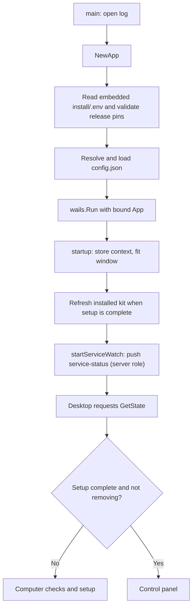
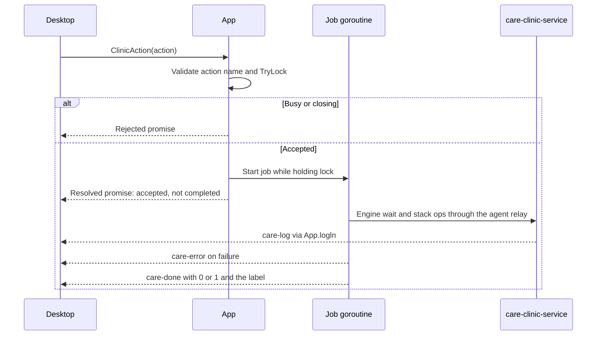

# Wails application and API

[Documentation index](README.md)

This guide covers `app/*.go` and the desktop-to-Go contract. Lower-level work is delegated to the [clinic engine](clinic-lifecycle.md), the [host service](../app/cmd/care-clinic-service/README.md) and [native packages](native-integrations.md). The app is only a user interface: the clinic runs in `care-clinic-service` whether or not the app is open.

## Entry point and embedded resources

[`main.go`](../app/main.go) embeds two independent trees:

| Embedded filesystem | Source at compile time | Runtime use |
| --- | --- | --- |
| `assets` | `app/frontend/dist/` | Wails serves the desktop control panel from the executable. |
| `installFS` | `app/install/` | The application reads release pins and copies the deployment kit that it uploads to the engine. |

The desktop UI is not served from the CARE frontend container. It must remain usable when the clinic stack is stopped or not installed.

`main()` opens the diagnostic log, installs its fatal-error callback, constructs `App`, records version/pin information, and calls `wails.Run`. Only the `App` instance is bound. Exported receiver methods become desktop-callable methods; helper functions and unexported methods do not.

The window title is `CARE Clinic`, with an initial size of 1100 by 700 and a minimum of 720 by 560. On macOS, `HideWindowOnClose` is enabled. The single-instance identifier is `ohc.care-clinic`; a second launch shows and unminimizes the existing window.

### The initial size has to fit the smallest supported screen

Wails centres the window on the work area, positioning it at the work area's midpoint minus half the window height. A window taller than the work area therefore gets a **negative** top coordinate, and the title bar — with the close and maximise buttons — is pushed above the top of the screen where it cannot be reached. Growing the default size is not a neutral change: it fails this way on any screen shorter than the value chosen, and a clinic computer is as likely to be a small laptop as a desktop.

The initial 700 clears the work area of a 1366×768 laptop, the smallest common panel. `fitWindowToScreen` in [app_lifecycle.go](../app/app_lifecycle.go) then covers anything smaller, shrinking to the current screen less `screenMargin` and re-centring, with the configured minimum as the floor.

Two constraints shape that helper. `Screen.Size` is the whole monitor in logical pixels, which is the unit `WindowSetSize` takes, but it does **not** exclude the taskbar; `screenMargin` is the allowance for that and for window chrome, not decoration. And `OnStartup` runs on its own goroutine while the window is being shown, so the helper cannot be the only thing keeping the window on screen — resizing there races the first paint. It narrows a window that already fits; it does not rescue a default that does not.

It also guards its context before calling the runtime. `wruntime` resolves the frontend from a `frontend` value carried by the lifecycle context, and when that value is absent it reports the problem with `log.Fatalf` — which exits the process rather than returning an error. Any test or future caller that reaches a runtime call with a plain `context.Background()` therefore terminates the binary mid-run instead of failing a case. Checking for the value first is what keeps that path inert outside a real window.

Startup failures are written to the log and stderr. `fatal()` attempts a native error dialog on macOS or Windows, then exits with status 1.

## Startup and shutdown

The first-run start screen only navigates; it does not save a role. On entry to
server setup, the UI waits for `BeginServerSetup` to succeed before its
role-guarded reads and writes. Client navigation does not persist anything;
`ConnectClient` records that role when connecting begins. Existing or partial
installations infer Server.

`NewApp` does not treat a missing embedded release file or malformed saved
configuration as an ordinary first run; it returns an error.

[`refreshInstallDir()`](../app/app_lifecycle.go) runs under the mutation gate
for a completed, non-removing server and refreshes the kit files. The next
Start uploads them. An error is logged.

The app does not start the clinic on launch: the service boots the engine at
startup and brings the stack up after each engine boot. The panel reads
engine, stack, forward and mDNS state from `service-status`, which the
watcher pushes on change and retries every 3 seconds while the service is
unreachable. The app does not advertise mDNS; the service does.

`shutdown()` cancels pending permission confirmations and stops the watcher.

### Closing the application

`beforeClose()` first attempts the exclusive operation lock. `run` and
`withLabeledJob` record the running job's label (`activeJob`), so a refused
lock tells `beforeClose` what is running. Any running job gets a Quit/No
question (default No) worded by `jobQuitPrompt`:

| Running job | What the question says |
| --- | --- |
| `setup` | Setup stops where it is; next time you can continue or remove the unfinished install. |
| `service` | If the administrator prompt was accepted, the service install finishes on its own. |
| `start`, `restart`, `stop` | The service keeps starting or stopping the clinic in the background. |
| `uninstall` | Quitting can leave CARE partly removed; remove it again to finish. |
| `app-update` | The current version keeps working. A bundle swap already handed to macOS finishes on its own. |
| Anything else | Generic wording pointing at the log; the clinic keeps running in the service. |

The frontend registers with `SetQuitDialogReady(true)`. Running-job questions
then arrive as `quit-requested` with an immutable request ID; **Keep
waiting** is the focused primary action. `RespondToQuit(id, quit)` consumes
only the current request. Until registration, a native confirmation is used.

`beforeClose` returns "prevent" at once, so the main thread never waits on a
dialog. Confirming sets `quitConfirmed` and calls `wruntime.Quit`. Nothing is
cancelled: service operations and elevated scripts that already started may
finish in the background. Only one dialog is shown at a time (`busyShown`).

With no job running, closing just quits. There is no "stop the clinic"
question: the clinic keeps running in the service; use **Stop** in the panel
to stop it. On macOS `HideWindowOnClose` hides the window without exiting.

### In-window permission confirmations

[`app_confirmation.go`](../app/app_confirmation.go) implements the engine's
`Confirm(title, message) bool` callback without coupling `internal/` to React
or Wails. [`confirmation-dialog.tsx`](../app/frontend/src/components/confirmation-dialog.tsx)
is mounted at the application root, alongside the running-job quit dialog.
It is available during installation and removal, not only in the panel.

1. The component subscribes to `confirmation-requested` and
   `confirmation-cancelled`, then calls `SetConfirmationDialogReady(true)`.
   Registration returns the current immutable request snapshot, or `null`.
2. A native caller queues `{id, title, message}` and waits on that request's
   answer channel. Only one request may be pending. The caller retains its
   operation lock; confirmation uses a separate mutex, so answering cannot
   deadlock on that lock.
3. The dialog presents the concise message with Continue and Cancel. Cancel has
   initial focus and Escape declines. The component sends
   `RespondToConfirmation(id, approved)` once while a response is pending.
4. Go consumes only the matching current ID. Wrong, stale and replayed IDs
   reject and are logged. A delayed response or registration snapshot cannot
   close a newer dialog or revive a cancelled request.
5. Unregistration, runtime-context cancellation or shutdown declines a pending
   request and emits its cancelled ID. Shutdown also prevents new requests.

Response failures remain visible with a recheck/retry path. An unavailable
frontend before registration uses the explicit native confirmation fallback;
missing runtime and dialog errors are not approval. The fallback follows the
platform behavior described in [native dialog answers](#native-dialog-answers-are-not-the-button-labels).

This protocol transports consent, not operating-system credentials. Password,
Touch ID, certificate-security and UAC prompts still come from native system
tools. Decline handling belongs to the caller: optional local-browser setup
can be skipped, whereas incomplete cleanup must remain reported. Client Connect
already provides its own explicit consent and does not add this extra question.

## Concurrency and job protocol

### Execution helpers

| Helper | Lock | Completion contract |
| --- | --- | --- |
| `run(fn, markSetup, label)` | Exclusive `TryLock` held by the job goroutine | Method returns after acceptance; completion uses events. |
| `withJob(fn)`, `withServerJob(fn)`, `withLabeledJob(label, fn)` | Exclusive `TryLock` | Method returns the callback's result. `withServerJob` also requires the server role; `withLabeledJob` records a label for the quit prompt. |
| `withReadJob(fn)` | Shared `TryRLock` | Other readers may run simultaneously. Used by `ReadEnv`. |

All reject a closing application. A busy lock returns `something else is still running - wait for it to finish`. There is no queue or automatic retry.

For setup, `markSetup=true` means the runner persists `SetupDone=true` only
after the job succeeds, then emits `setup-done`. The frontend waits for both
`setup-done` and the matching successful `care-done` before entering the
panel. A failure emits `setup-failed {can_retry}` first. `RetrySetup` reuses
the in-memory `setupAttempt` (and its password) under the same lock; it is
lost when the app restarts. See [server onboarding](onboarding.md#3-install).

A job can be waiting for an in-window confirmation or an OS approval while
holding the lock. A panic inside the job is logged with a stack trace and
reported as a failure.

### Lifecycle and authorization guards

| Guard | What it requires |
| --- | --- |
| `requireServer()` | The saved role is `server`. |
| `requireSetup()` | Server role, not removing, and setup complete. |
| `requireAdmin(password)` | Server role, setup complete and bcrypt accepts the password against `AdminPwHash`. |
| `clientRoleAvailable()` | The saved role is not `server` and the install directory holds no earlier setup. |

`ClinicAction` needs no admin password. `ReadEnv`, `WriteEnv`,
`SetUpdateChecks` and `RunUninstall` check the password on every call; the
Advanced unlock in the UI is not a backend session.

## Complete bound method reference

The following methods are declared in [`wails.d.ts`](../app/frontend/src/wails.d.ts); every call returns a promise, and a Go `error` rejects it. **query** means no job lock, **read** the shared gate, **sync** an exclusive synchronous gate, and **job** an exclusive asynchronous job.

### Role and client connection

| Method | Result | Execution and contract |
| --- | --- | --- |
| `GetState()` | `AppState` | Query. |
| `BeginServerSetup()` | `void` | Sync. Saves the Server role; rejected once another role is saved. |
| `ClearRole()` | `void` | Sync. Undoes a role choice nothing was built on yet; otherwise refuses with the uninstall-first message. |
| `FindClinic(address)` | `ClinicInfo` | Validates the address and reads the clinic certificate over HTTP, held in memory only. |
| `ClientPreflight()` | `ClientPreflight` | What connecting would clean up first. |
| `ConnectClient(address)` | `void` | Sync. Saves the Client role, cleans up, trusts the pinned certificate, verifies HTTPS. Emits `client-connect-progress`. |
| `ClientReachable()` | `ClientReachability` | Query; read-only reachability check. |
| `DisconnectClient()` | `void` | Sync. Removes this client's hosts entry and owned certificate, then clears the role. |

### Server setup

| Method | Result | Execution and contract |
| --- | --- | --- |
| `HostChecks()` | `hostcheck.Report` | Query. Virtualization, memory, disk and service checks; `ready` is false while any fails. |
| `InstallService()` | `void` | Sync, label `service`. One macOS administrator prompt installs `care-clinic-service`, then waits for its socket. |
| `ValidateDomain(name)`, `ValidatePassword(pw)` | `string` | Query. Empty when valid, else the message. |
| `MDNSStatus(name)` | `NameStatus` | Query. Whether the name is free on the network or already this computer's. |
| `SetMDNSName(name)` | `void` | Sync. Saves the name before setup. |
| `RunSetup(name, adminPassword)` | `void` | Job `setup`. Engine install, clinic install and start. |
| `RetrySetup()` | `void` | Job `setup`. Resumes the in-memory failed attempt. |
| `CleanupFailedInstall()` | `void` | Sync. Removes an unfinished clinic from the engine and the install files; keeps the role, service and engine. |

### Clinic and service

| Method | Result | Execution and contract |
| --- | --- | --- |
| `ServiceStatus()` | `ServiceState` | Query. Last service status; also pushed as `service-status`. |
| `ClinicAction(action)` | `void` | Job `start`, `stop` or `restart`. No password. Start waits for the engine and brings the stack up; stop keeps containers and data. |
| `ClinicStatus()` | `string` | Query. One `service state` line per container. |
| `VerifyAdminPassword(pw)` | `boolean` | Query. |
| `ChangeAdminPassword(current, new)` | `void` | Sync. Changes only the local CARE Clinic hash, not the CARE web login. |
| `ReadEnv(name, password)` | `string` | Read. `backend` or `frontend`. |
| `WriteEnv(name, content, password)` | `void` | Sync. Validates dotenv syntax and writes atomically; Start applies it. |
| `RunUninstall(removeData, password)` | `void` | Job `uninstall`. See [cleanup](cleanup-and-uninstall.md). |
| `NetworkStatus()`, `FixNetwork()` | `netfix.Status`, `void` | macOS firewall check and fix (job `network`). |
| `HomeAccessStatus()`, `EnableHomeAccess()`, `DisableHomeAccess()` | `HomeAccess`, `boolean`, `void` | Tailscale home access. `EnableHomeAccess` returns true when port 8480 isn't answering yet. See [home access](home-access.md). |

### App updates and utilities

| Method | Result | Execution and contract |
| --- | --- | --- |
| `CheckAppUpdate()` | `AppUpdate` | Checks the latest `praffq/care_clinic` GitHub release (`desktop-v<version>` tag) unless app update checks are off. |
| `InstallAppUpdate()` | `void` | Job `app-update`; emits `app-update-progress`. |
| `GetUpdateChecks()`, `SetUpdateChecks(app, password)` | `UpdateChecks {app}`, `void` | The app update-check switch. |
| `OpenURL(url)`, `ChooseFolder(title)` | `void`, `string` | Native browser and folder dialog; empty string means cancelled. |
| `LogPath()`, `OpenLogFolder()` | `string`, `void` | Diagnostic log. |
| `UninstallRequested()`, `ExitUninstall()` | `boolean`, `void` | Windows uninstaller mode (`--uninstall`). |
| `CanRemoveApp()`, `RemoveApp()` | `boolean`, `void` | Remove this copy of the app after the computer is no longer set up. |
| `SetQuitDialogReady(ready)`, `RespondToQuit(id, quit)` | `QuitRequest` or `null`, `void` | Running-job quit UI. |
| `SetConfirmationDialogReady(ready)`, `RespondToConfirmation(id, approved)` | `ConfirmationRequest` or `null`, `void` | Permission UI. |

### Native dialog answers are not the button labels

`MessageDialogOptions.Buttons` is a request, not a contract. Windows ignores it
entirely and renders a fixed native message box per dialog type, so the answer
is drawn from a closed set rather than from the labels that were asked for:

| Dialog type | Windows box | Answers it can return |
| --- | --- | --- |
| `QuestionDialog` | `MB_YESNO` | `Yes`, `No` |
| `InfoDialog`, `ErrorDialog` | `MB_OK` | `Ok` |
| `WarningDialog` | `MB_OKCANCEL` | `Ok`, `Cancel` |

macOS and Linux do render the requested labels and return the one that was
clicked. Code that compares the answer against its own label therefore works
on those platforms and silently fails on Windows: the comparison never matches,
and whatever the dialog guarded is skipped with no error and no log line. Treat
a custom label and the platform answer as two spellings of the same choice.

`DefaultButton` is subject to the same rule. The Windows path only moves the
default off the first button when that field is literally `No`; any other
spelling, including `Cancel`, leaves the first button selected. A destructive
action must use `No` if it is not to arrive pre-armed.

`affirmative()` and `askToProceed()` in [app_ui.go](../app/app_ui.go) hold this
for native confirmations. The fallback in `confirmDialog()` also interprets
answers through `affirmative()`; the registered in-window dialog instead sends
an explicit boolean with its request ID.

Questions and failures otherwise belong in the window: a failed job emits
`care-error` instead of an error box. A choice between more than two outcomes
cannot be a single message box, because the Windows box has two buttons.

## Every returned error is in the log

An error that reaches the interface is shown in plain language, and the panel
tells the operator that the details are in the log file. That promise is kept
centrally rather than per method. The job helpers write
whatever they return through `App.logged`, which names the bound method by
walking out to the first exported `(*App)` frame on the stack, so the log reads
`ConnectClient: could not reach the clinic ...`. Bound methods that take no job
lock — the queries — carry `defer a.logError(&err)` instead.

A logged error is wrapped in an internal `loggedError` marker, so a bound method
that calls another one produces a single line rather than the same failure under
two names. The marker changes nothing the interface sees: `Error()` is the
original text.

## Events and result shapes

| Event | Payload | Meaning |
| --- | --- | --- |
| `care-log` | One string | A line already written to the host log. |
| `care-done` | `0` or `1`, then the job label | An App job succeeded or failed. |
| `care-error` | Title and detail | A job failed; the detail is already in the log. |
| `setup-done` | `true` | Setup succeeded and `SetupDone` was saved. |
| `setup-failed` | `SetupFailure {can_retry}` | Sent before the failed `care-done`. |
| `service-status` | `ServiceState` | Service, engine, stack, forward and mDNS state changed. |
| `uninstalled` | `true` | Uninstall finished and the configuration was reset. |
| `app-update-progress` | `{phase, done, total}` | `downloading`, `verifying`, `installing`, `restarting` or `installer`. |
| `client-connect-progress` | `finding`, `connecting`, `checking` or `opening` | Client connection stages. |
| `quit-requested` | `{id, title, message}` | Running-job close request. |
| `confirmation-requested`, `confirmation-cancelled` | Request, or its ID | Permission questions. |

| Shape | Fields |
| --- | --- |
| `AppState` | `role`, `client_url`, `version`, `platform`, `setup_done`, `setup_started`, `mdns_name`. `setup_done` is false while removal is in progress. |
| `hostcheck.Report` | `checks` (`id`, `title`, `level` ok/warn/fail, `detail`, optional `action`), `ready`. |
| `ServiceState` | `installed`, `reachable`, `error`, `status` (the service API status), `summary` (`level`, `title`, `detail`, `running`, `notes`). Notes report mDNS conflicts and port listeners that failed. |
| `SetupFailure` | `can_retry`. |
| `AppUpdate` | `current`, `version`, `available`, `notes_url`, `asset`, `size`. |
| `ConfirmationRequest`, `QuitRequest` | `id`, `title`, `message`. |
| `NameStatus` | `ok`, `message`. |
| `HomeAccess` | Tailscale status fields plus `clinic_ready`. |
| `ClinicInfo`, `ClientPreflight`, `ClientReachability` | Client connection results. |

Go structs and their JSON tags are authoritative. [`types.ts`](../app/frontend/src/types.ts) mirrors them.

## JavaScript bridge behavior

[`bridge.ts`](../app/frontend/src/lib/bridge.ts) resolves `window.go.main.App` per call, waiting up to 10 seconds for runtime injection. Missing methods produce an error naming the method. `onCareEvent()` returns an unsubscription function. `logToHost()` is only for messages originating in the desktop interface; replaying `care-log` through it would duplicate output.

A stale React state value cannot override a Go lifecycle guard.

## Changing this boundary

When changing an exported `App` method, update its declaration in `wails.d.ts`, its call sites, and any changed data shape in `types.ts`. The binding check verifies method names and argument counts, not return types.

Use `run()` only when completion should be event-driven. Keep authorization and lifecycle checks inside the protected operation to avoid check-then-act races.
